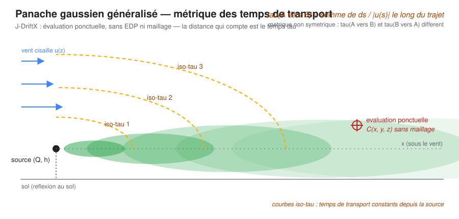

# J-DriftX

**Projet de recherche sur la modélisation à complexité réduite de la dispersion atmosphérique de scalaires passifs**, issu de la reprise et de la modernisation du projet historique **Drift-X** (J.-M. Brun & B. Mohammadi, 2006–2009).

J-DriftX étudie l'hypothèse qu'une représentation fondée sur des solutions de similitude et des temps de transport dirigés puisse permettre d'évaluer certains problèmes de dispersion à moindre coût, sans résoudre directement une EDP ni construire un maillage. La validité mathématique, le gain prédictif, le coût total et l'utilité applicative de cette approche **ne sont pas encore établis**. La calibration par assimilation de données, l'évaluation ponctuelle et l'identification de source restent des pistes conditionnelles, non des capacités validées.

Le projet historique est un **socle à reconstruire et à auditer, pas un carcan** : ses idées originales doivent être préservées et testées, ses erreurs éventuelles explicitement consignées puis corrigées dans la reconstruction, et les méthodes récentes intégrées si elles apportent un gain vérifiable. Le cas historique pesticides/viticulture est un point de référence ; l'élargissement à d'autres pollutions industrielles, urbaines, chimiques ou radiologiques ou nucléaires est une direction de recherche, sous réserve de modèles physiques et validations adaptés. Voir la [stratégie de reprise et d'élargissement](docs/42-strategie-reprise-et-elargissement-scientifique.md).

> **Statut scientifique :** hypothèse de recherche en phase de cadrage et de validation. La figure et la documentation conceptuelle illustrent l'approche envisagée ; elles ne constituent pas une validation de ses performances.

## Héritage (2006–2009)

| Année | Référence | Support |
|---|---|---|
| 2007 (année à authentifier) | [Modèles à complexité réduite de transport pour applications environnementales](https://hal.inrae.fr/tel-02589999/document) — J.-M. Brun | Thèse signalée par [AGRIS/INRAE](https://agris.fao.org/search/en/providers/122439/records/647471f379cbb2c2c1b2123c) ; PDF présent dans la branche de travail. Page de titre, pagination, année exacte et identité du binaire avec HAL encore à vérifier |
| 2006 | [Similitude généralisée et modélisation géométrique à complexité réduite](https://comptes-rendus.academie-sciences.fr/mecanique/item/10.1016/j.crme.2006.06.007.pdf) — B. Mohammadi & J.-M. Brun | *C. R. Mécanique* 334(10), 634–638 (PDF libre, Académie des sciences) |
| — | *Reduced order modelling of dispersion* — référence citée avec Mohammadi, Brun & Pironneau (2006) | Référence secondaire attestée, mais recueil et métadonnées éditoriales non confirmés |
| 2008 | [Reduced-Order Modelling of Dispersion](https://doi.org/10.1007/978-1-4020-8758-5_14) — J.-M. Brun & B. Mohammadi | Springer, CSM vol. 16, chap. 14, p. 245 et s. |
| 2008 | *Similitude and non symmetric geometry for dispersion modelling* — N. Bozon, B. Mohammadi & C. Sinfort | e-sta vol. 5 (STIC & Environnement'07) |
| 2009 | [A GIS-based atmospheric dispersion model — plateforme Drift-X](https://hal.science/hal-00468863) — N. Bozon, C. Sinfort & B. Mohammadi | Actes STIC & Environnement, HAL hal-00468863 |
| 2009 | [GIS-based atmospheric dispersion modelling](https://doi.org/10.1007/s12518-009-0006-0) — N. Bozon & B. Mohammadi | *Applied Geomatics* 1, 59–74 |
| 2010 | [A GIS-based atmospheric dispersion model](https://doi.org/10.3166/jesa.44.445-461) — N. Bozon, C. Sinfort & B. Mohammadi | *JESA* 44(4-5), 445–461 (version journal du papier STIC & Environnement 2009 / HAL hal-00468863) |

Détails : [docs/references.md](docs/references.md) — [fiches de lecture par papier source](docs/04-revues-papiers-sources.md) — [audit critique de l'article fondateur de 2006](docs/43-audit-article-mohammadi-brun-2006.md) — [sources primaires et extractions](raw/).

## Documentation

Le site documentaire (Quarto, publié sur GitHub Pages) présente le projet, ses fondements théoriques, les hypothèses et leurs limites :

📚 https://jm-brun.github.io/J-DriftX/

Pour comprendre l'ensemble du projet, commencer par la [carte d'articulation scientifique](https://jm-brun.github.io/J-DriftX/projet/carte-articulation.html), puis consulter [Lectures des sources](https://jm-brun.github.io/J-DriftX/projet/lectures.html), le [Glossaire](https://jm-brun.github.io/J-DriftX/glossaire.html), l'[utilité scientifique](https://jm-brun.github.io/J-DriftX/projet/utilite-scientifique.html) et le [fallback théorique](https://jm-brun.github.io/J-DriftX/projet/modele-jouet.html).

Les notes de pilotage (feuille de route détaillée, revue adversariale et arbitrages G0) sont conservées dans le dépôt privé associé. Le suivi public des questions ouvertes passe par les [issues](https://github.com/JM-Brun/J-DriftX/issues) ; les éléments scientifiques pérennes restent documentés dans les pages du site, les références bibliographiques et le code.

## Structure du dépôt

~~~
site/                 # Site Quarto
src/jdriftx/          # Cœur Python
tests/                # Tests unitaires et propriétés physiques
docs/                 # Synthèses scientifiques, bibliographie et bilans reproductibles
raw/                  # Sources primaires et documents bruts
.github/workflows/    # CI et publication du site
~~~

## Statut de l'implémentation mathématique

La fonction Python `jdriftx.metric.temps_transport` calcule actuellement une somme `longueur / norme(vitesse)` sur une polyligne fournie par l'appelant. Elle ne calcule pas les caractéristiques du champ, ne projette pas le point cible sur une caractéristique et ignore le signe des vecteurs vitesse. Elle **n'est donc pas une implémentation de la pseudo-distance historique de 2006**. Une fonction distincte `pseudo_distance_uniforme` fournit une référence analytique limitée au champ uniforme 2D; elle n'est pas généralisée aux champs variables. Voir le [glossaire mathématique autonome G0-S](docs/30-glossaire-mathematique-autonome-g0s.md), la [revue mathématique ciblée](https://jm-brun.github.io/J-DriftX/etat-art/revue-mathematique.html) et le [bilan reproductibilité/preuves du MVP-S 1D](docs/21-bilan-mvp-s-1d.md).

## Développement

Le dépôt utilise [uv](https://docs.astral.sh/uv/), pyproject.toml, [Ruff](https://docs.astral.sh/ruff/), [pre-commit](https://pre-commit.com) et [pytest](https://pytest.org).

~~~bash
uv sync
uv run pytest --cov=jdriftx
uv run ruff check .
uv run ruff format --check .
uv run pre-commit run --all-files
~~~

Les tests doivent vérifier les propriétés mathématiques et physiques uniquement sous les hypothèses qui les garantissent. Un test de propriété ne démontre pas, à lui seul, l'exactitude empirique ni l'utilité applicative du modèle.

La charte qualité détaillée — code orienté objet avec responsabilités séparées, typage strict, structures typées plutôt que `dict`/DataFrame, TDD Given/When/Then, couverture, choix raisonné des dépendances — est dans [CONTRIBUTING.md](CONTRIBUTING.md).

## Statut et prochaine décision

**État des portes :** le cadrage documentaire G0 a été franchi le 22 octobre 2026 ; G0-S autorise une exploration mathématique minimale, tandis que G0-A (utilité applicative) reste non démontrée. Le cas far-field de dérive de pulvérisation demeure un candidat, pas une cible validée. Voir la [carte d'articulation scientifique](docs/18-carte-articulation-scientifique.md), le [cadre de décision et de preuve](docs/08-decision-utilite-et-preuve.md), les [questions scientifiques ouvertes](https://github.com/JM-Brun/J-DriftX/issues) et les [limites connues](https://jm-brun.github.io/J-DriftX/hypotheses/limites.html).

## Licence

- **Code** (`src/`, `apps/`, `tests/`) : GNU General Public License v3 ou ultérieure — texte intégral dans [LICENSE](LICENSE).
- **Documentation** (`site/`, `docs/`, `README.md`, `CONTRIBUTING.md`) : Creative Commons Attribution 4.0 International (CC BY 4.0) — texte intégral dans [LICENSE-docs.txt](LICENSE-docs.txt).
- **Sources tierces** (`raw/`) : conservent les droits de leurs titulaires d'origine ; elles ne sont pas relicenciées par ce dépôt.
