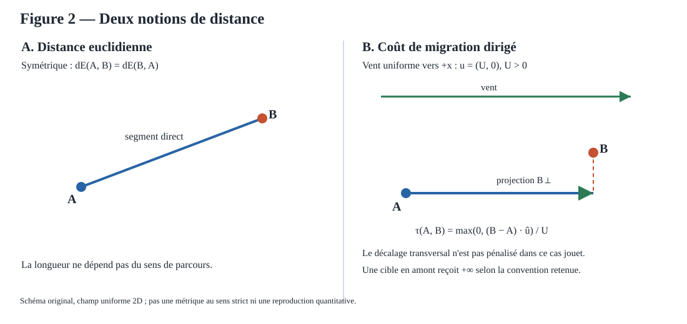

# Figure 2 — Distance euclidienne et coût de migration dirigé



## Statut

**R0/R1 — schéma explicatif dans un champ uniforme 2D.** Cette illustration est créée pour J-DriftX ; elle ne copie pas l'image Springer et ne constitue pas une reproduction quantitative des données historiques.

La distance euclidienne est symétrique. Le coût dirigé dépend du sens du vent : pour le cas uniforme retenu, seule la projection longitudinale positive est facturée et la séparation transversale est ignorée. Selon la convention documentée par `pseudo_distance_uniforme`, une cible située en amont reçoit un coût infini. Le coût peut aussi être nul pour deux points distincts partageant la même coordonnée longitudinale : il ne s'agit donc pas d'une métrique au sens strict.

La formule schématisée est limitée à un champ constant non nul :

\[
\tau(A,B)=\begin{cases}
\frac{(B-A)\cdot\hat{u}}{\|u\|}, & (B-A)\cdot\hat{u}\geq 0,\\
+\infty, & (B-A)\cdot\hat{u}<0.
\end{cases}
\]

Ici \(\hat{u}=u/\|u\|\). Les unités sont cohérentes si les coordonnées sont en mètres et la vitesse en mètres par seconde ; le résultat est alors en secondes. La formule ne modélise ni les caractéristiques d'un champ variable, ni une projection sur des trajectoires courbes, ni la dispersion/diffusion.

## Génération et tests

Le SVG est généré par `jdriftx.figures.figure_02.render_figure_02_svg`, sans dépendance de rendu externe. Les tests vérifient la stabilité du générateur et la présence des qualifications scientifiques. Pour régénérer localement :

```bash
uv run python -c 'from pathlib import Path; from jdriftx.figures.figure_02 import render_figure_02_svg; Path("site/images/figure-02-geometries.svg").write_text(render_figure_02_svg(), encoding="utf-8")'
uv run pytest tests/test_figure_02.py
```

La copie versionnée du SVG doit rester strictement synchronisée avec la sortie du générateur. Ce livrable ne valide ni l'utilité applicative G0-A, ni la formulation générale historique.

## Référence

Brun, J.-M. & Mohammadi, B. (2008), “Reduced-Order Modelling of Dispersion”, chapitre 14, p. 253, dans *Partial Differential Equations: Modelling and Numerical Simulation*, https://doi.org/10.1007/978-1-4020-8758-5_14.
