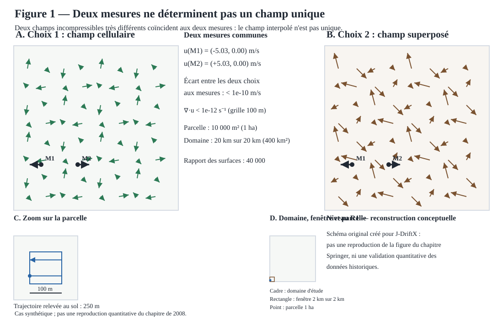

# Figure 1 — Deux mesures ne déterminent pas un champ unique



## Statut

**R1 — reconstruction conceptuelle, étape B du plan de figures du chapitre de 2008.** Cette illustration est créée pour J-DriftX ; elle ne copie pas l'image Springer et ne constitue pas une reproduction quantitative des données historiques.

Un champ de vent interpolé à partir de deux mesures ponctuelles n'est pas unique : le schéma oppose deux champs incompressibles très différents — un champ cellulaire périodique (choix 1) et sa superposition avec une perturbation de plus petite longueur d'onde (choix 2) — qui coïncident exactement aux deux points de mesure M1 et M2. L'écart mesuré entre les deux choix aux mesures est de l'ordre de 10⁻¹⁵ m/s (seuil affiché 1e-10 m/s) ; hors des mesures, les deux champs diffèrent de plusieurs m/s. La reconstruction d'un champ exige donc des hypothèses supplémentaires — régularité, conditions aux limites, données supplémentaires — que ce cas synthétique rend explicites.

Les deux champs sont incompressibles par construction : u = ∂ψ/∂y et v = -∂ψ/∂x donnent ∇·u = 0 pour toute fonction de courant ψ suffisamment régulière (vérifié numériquement : divergences maximales mesurées de l'ordre de 10⁻¹⁵ à 10⁻¹⁴ s⁻¹ par différences finies centrées sur la grille de 100 m, seuil affiché 1e-12 s⁻¹).

Les valeurs affichées par le schéma (vents mesurés, surfaces, longueur de trajectoire) sont produites par la tranche « reconstruction du vent » du module `jdriftx.experiences.reconstruction_vent` : une configuration typée (`ScenarioReconstruction`, dont la `parcelle` et le `domaine` sont des `Rectangle` validés), deux champs à fonction de courant (`ChampFonctionCourant`, `SuperpositionChamps`), résolue par `resoudre_scenario`, avec résultats immuables (`ResultatReconstruction`) et manifeste (`ManifesteReconstruction`). La figure consomme ces résultats calculés : elle ne duplique pas les formules et ne peut pas diverger silencieusement de l'implémentation testée. Le cas synthétique est `SCENARIO_DEFAUT` : mesures M1 = (250, 500) m et M2 = (750, 500) m, parcelle de 100 m sur 100 m (1 ha) dans un domaine de 20 km sur 20 km (400 km², rapport de surfaces 40 000), trajectoire relevée au sol de 250 m.

## Génération, manifeste et tests

Le SVG est généré par `jdriftx.figures.figure_01.render_figure_01_svg`, sans dépendance de rendu externe ; les vents affichés proviennent de `resoudre_scenario(SCENARIO_DEFAUT)` (module `jdriftx.experiences.reconstruction_vent`). Le manifeste de l'expérience est assemblé par `construire_manifeste` : identifiant `jdriftx-reconstruction-vent-001`, niveau R1, source (DOI du chapitre), hypothèses, limites, version du package et commande de reproduction ; son export JSON est confiné à la frontière (`ManifesteReconstruction.vers_dict`). Les tests vérifient la validation des invariants (exactement deux mesures, mesures distinctes et dans le domaine, parcelle entièrement contenue, dimensions strictement positives, trajectoire dans la parcelle à points consécutifs distincts), les valeurs analytiques (vents mesurés ±A·k, coïncidence des deux choix sous 1e-10 m/s, divergences sous 1e-12 s⁻¹, longueur de trajectoire exacte de 250 m, surfaces 1 ha et 400 km², rapport 40 000, frontière incluse), la somme exacte des superpositions de champs, l'immuabilité des résultats, le manifeste, la stabilité du générateur SVG et la cohérence des valeurs affichées avec l'implémentation partagée. Les nouveaux tests suivent le format Given/When/Then de la charte qualité. Pour régénérer localement :

```bash
uv run python -c 'from pathlib import Path; from jdriftx.figures.figure_01 import render_figure_01_svg; Path("site/images/figure-01-reconstruction-vent.svg").write_text(render_figure_01_svg(), encoding="utf-8")'
uv run pytest tests/test_champ_analytique.py tests/test_reconstruction_vent.py tests/test_figure_01.py
```

La copie versionnée du SVG doit rester strictement synchronisée avec la sortie du générateur. Ce livrable ne valide ni l'utilité applicative G0-A, ni la formulation générale historique.

## Référence

Brun, J.-M. & Mohammadi, B. (2008), “Reduced-Order Modelling of Dispersion”, chapitre 14, p. 253, dans *Partial Differential Equations: Modelling and Numerical Simulation*, https://doi.org/10.1007/978-1-4020-8758-5_14.
