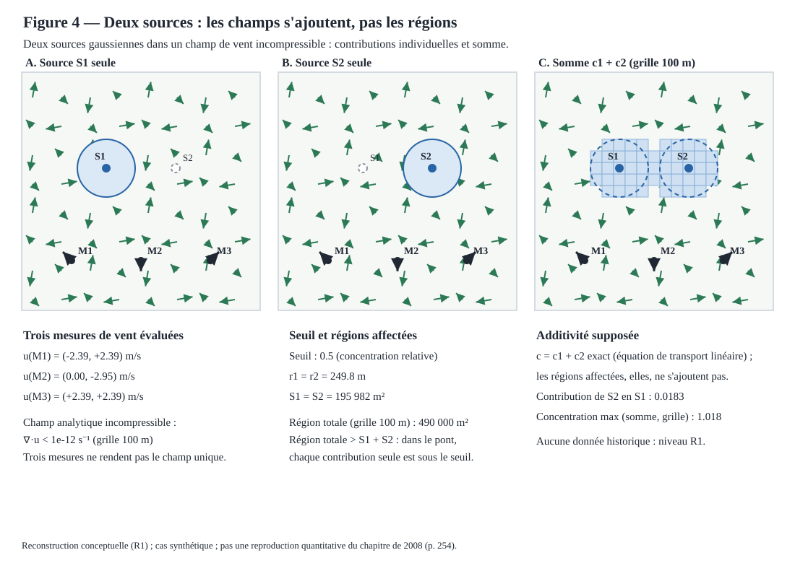

# Figure 4 — Deux sources : les champs s'ajoutent, pas les régions



## Statut

**R1 — reconstruction conceptuelle, étape C du plan de figures du chapitre de 2008** (cf. [docs/16](16-chapitre-2008-reconstruction-figures.md) et l'issue #57 ; la figure 1 est livrée dans [docs/23](23-figure-01-reconstruction-vent.md), la figure 2 par la PR #60). Ce livrable ne reproduit pas la figure du chapitre Springer et ne valide aucune donnée historique : il établit, sur un cas synthétique, la distinction centrale entre l'additivité des champs et celle des régions affectées.

La concentration totale est exactement la somme des contributions individuelles tant que l'équation de transport est linéaire :

\[ c(x, y) = c_1(x, y) + c_2(x, y), \qquad c_i(x, y) = A_i \exp\!\left(-\frac{\|(x, y) - S_i\|^2}{L_i^2}\right). \]

Les régions affectées, en revanche, ne s'ajoutent pas. Chaque source possède un disque analytique

\[ \{c_i \geq s\} \quad \text{de rayon} \quad r_i = L_i \sqrt{\ln(A_i / s)}, \]

mais la région totale \(\{c_1 + c_2 \geq s\}\) n'est ni l'union ni la somme des disques : dans le cas jouet retenu (deux disques de rayon \(r \approx 250\) m séparés de 600 m), elle contient un « pont » entre les sources où chaque contribution seule reste sous le seuil, et sa surface estimée sur la grille dépasse la somme des surfaces individuelles. La fusion des régions n'est pas une additivité : c'est le point scientifique de la figure.

Le champ de vent est analytique et incompressible (divergence numérique inférieure à 1e-12 s^-1 sur la grille de calcul). Il est évalué — et non assimilé — aux trois points de mesure : l'expérience de reconstruction du vent établit que deux mesures ne suffisent pas à uniciser le champ, et trois mesures ne lèvent pas cette non-unicité ; elles rendent seulement la superposition observable en trois points.

## Tranche verticale

Toutes les valeurs affichées proviennent de la tranche typée `jdriftx.experiences.superposition_sources` :

- `SourceGaussienne` : source synthétique à profil gaussien isotrope, concentration relative sans unité ;
- `ScenarioSuperposition` : deux sources distinctes, un champ `ChampFonctionCourant`, exactement trois mesures, un seuil, une fenêtre et un domaine (`Rectangle` partagé avec l'expérience de reconstruction du vent) ;
- `resoudre_scenario` : vents évalués aux mesures, divergence numérique maximale, rayons et surfaces analytiques, surface totale estimée sur une grille 100 m, concentration maximale et contributions croisées ;
- `construire_manifeste` / `ManifesteSuperposition.vers_dict` : export JSON reproductible, niveau R1, commande `uv run` incluse.

Le scénario par défaut place les sources en \(S_1 = (700, 1200)\) et \(S_2 = (1300, 1200)\) (amplitudes 1, échelles 300 m), les mesures en \(M_1 = (400, 400)\), \(M_2 = (1000, 400)\), \(M_3 = (1600, 400)\), le seuil à 0,5, la fenêtre à 2 km et le domaine à 20 km × 20 km. Les invariants sont validés à la construction : exactement trois mesures distinctes dans la fenêtre, sources et disques affectés dans la fenêtre, fenêtre contenue dans le domaine, seuil strictement positif et sous la plus petite amplitude.

## Génération, manifeste et tests

Le SVG se régénère depuis la tranche :

```bash
uv run python -c 'from pathlib import Path; from jdriftx.figures.figure_04 import render_figure_04_svg; Path("site/images/figure-04-superposition-sources.svg").write_text(render_figure_04_svg(), encoding="utf-8")'
```

Les tests de la tranche et du rendu :

```bash
uv run pytest tests/test_superposition_sources.py tests/test_figure_04.py -q
```

Les tests couvrent : les invariants du scénario (exactement trois mesures distinctes, seuil sous la plus petite amplitude, sources et disques dans la fenêtre), les valeurs analytiques (rayon, surfaces, contributions croisées), la divergence numérique, la non-additivité des régions (surface totale supérieure à la somme des surfaces individuelles), le manifeste et son export JSON, la sortie SVG (bien formée, déterministe, valeurs issues de la tranche) et la synchronisation de la copie versionnée avec le générateur. La copie versionnée du SVG doit rester strictement synchronisée avec la sortie du module : le test d'égalité octet par octet échoue sinon.

## Référence

Brun, J.-M. & Mohammadi, B. (2008), « Reduced-Order Modelling of Dispersion », chapitre 14, p. 254, DOI 10.1007/978-1-4020-8758-5_14 : source du plan de figures. Ce livrable n'utilise ni sa géométrie ni ses paramètres : c'est un objet de vérification conceptuel, niveau R1, sans prétention quantitative.
