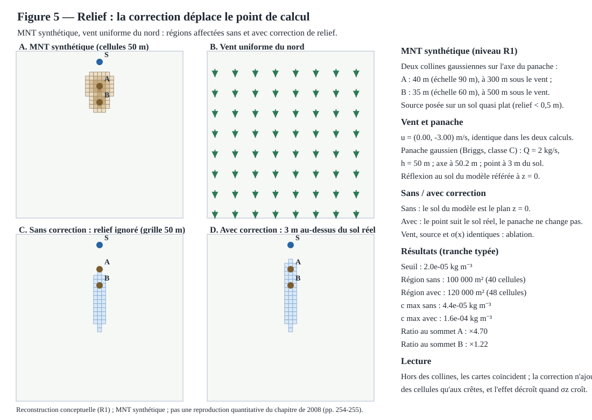

# Figure 5 — Relief : la correction déplace le point de calcul



## Statut

**R1 — reconstruction conceptuelle, étape D du plan de figures du chapitre de 2008** (cf. [docs/16](16-chapitre-2008-reconstruction-figures.md) et l'issue #57 ; la figure 1 est livrée dans [docs/23](23-figure-01-reconstruction-vent.md), la figure 2 par la PR #60, la figure 4 par la PR #190). Ce livrable ne reproduit pas la figure du chapitre Springer et ne valide aucune donnée historique : il établit, sur un cas synthétique, ce que change — et ne change pas — une correction de relief minimale.

Le MNT est synthétique : deux collines gaussiennes (module `jdriftx.terrain`), posées sur l'axe du panache — A (40 m, échelle 90 m) à 300 m sous le vent, B (35 m, échelle 60 m) à 500 m. La source est posée sur un sol quasi plat (relief < 0,5 m), le vent est uniforme du nord (0, −3) m/s, le panache est la solution de similitude gaussienne (Briggs, classe C), l'axe est horizontal à environ 50,2 m au-dessus du plan z = 0.

Deux conventions d'évaluation de la concentration au sol sont comparées :

- **sans correction**, le modèle ignore le relief : le sol du modèle est le plan z = 0 et le point de calcul est posé à 3 m au-dessus de ce plan ;
- **avec correction**, le point de calcul est posé à 3 m au-dessus du sol réel.

Le vent, la source, les écarts-types de Briggs et le terme de réflexion au sol (référé au sol du modèle, z = 0, dans les deux calculs) sont strictement identiques : la seule différence est l'altitude du point de calcul. C'est une ablation : hors des collines, les deux cartes coïncident exactement ; la correction n'ajoute des cellules affectées qu'autour des crêtes. À seuil fixé (2×10⁻⁵ kg m⁻³, grille 50 m), la région passe de 100 000 m² (40 cellules) à 120 000 m² (48 cellules) : les huit cellules ajoutées entourent la colline A. Le rapport de concentration vaut ×4,70 au sommet A (σ_z ≈ 23 m) et ×1,22 au sommet B (σ_z ≈ 38 m) : l'effet décroît à mesure que le panache s'élargit.

La correction est volontairement minimale et documentée comme telle : ni déviation du panache par les collines, ni allongement du trajet sous le vent, ni perturbation du vent par le relief. Le terme de réflexion au sol reste référé au sol du modèle (z = 0) : c'est la convention du cas plat, réutilisée telle quelle dans les deux calculs.

## Tranche verticale

Toutes les valeurs affichées proviennent de la tranche typée `jdriftx.experiences.relief` :

- `CollineGaussienne` : colline synthétique à profil gaussien, évaluée par `jdriftx.terrain.terrain_surface` ;
- `ScenarioRelief` : exactement deux collines à centres distincts, un vent uniforme, une source sur sol quasi plat, un débit, une classe de Pasquill, une hauteur de source, un seuil, une hauteur d'évaluation, une fenêtre et un domaine (`Rectangle` partagé avec l'expérience de reconstruction du vent) ;
- `concentrations_au_point` : couple (sans, avec) évalué par `jdriftx.similitude.concentration_panache`, nul en amont de la source ;
- `resoudre_scenario` : altitude maximale du MNT sur la grille 50 m, altitude de l'axe, nombres de cellules et surfaces des régions, concentrations maximales, rapports aux centres des deux collines ;
- `construire_manifeste` / `ManifesteRelief.vers_dict` : export JSON reproductible, niveau R1, commande `uv run` incluse.

Les invariants sont validés à la construction : exactement deux collines à centres distincts dans la fenêtre, collines sous le vent de la source, source dans la fenêtre et sur un sol quasi plat (relief < 0,5 m), vent de norme strictement positive, débit, hauteurs et seuil strictement positifs, classe de Pasquill valide, fenêtre contenue dans le domaine.

## Génération, manifeste et tests

Le SVG se régénère depuis la tranche :

```bash
uv run python -c 'from pathlib import Path; from jdriftx.figures.figure_05 import render_figure_05_svg; Path("site/images/figure-05-relief.svg").write_text(render_figure_05_svg(), encoding="utf-8")'
```

Les tests de la tranche et du rendu :

```bash
uv run pytest tests/test_relief.py tests/test_figure_05.py -q
```

Les tests couvrent : les invariants du scénario (deux collines, vent, débit, classe, seuil, source, fenêtre), la nullité en amont de la source, la coïncidence exacte hors du relief, l'inclusion cellule par cellule de la région sans correction dans la région corrigée, le rapport analytique au sommet (profil vertical gaussien via `sigma_z`), les agrégats reproductibles du scénario par défaut, le manifeste et son export JSON, la sortie SVG (bien formée, déterministe, valeurs issues de la tranche) et la synchronisation de la copie versionnée avec le générateur. La copie versionnée du SVG doit rester strictement synchronisée avec la sortie du module : le test d'égalité octet par octet échoue sinon.

## Référence

Brun, J.-M. & Mohammadi, B. (2008), « Reduced-Order Modelling of Dispersion », chapitre 14, pp. 254-255, DOI 10.1007/978-1-4020-8758-5_14 : source du plan de figures. Ce livrable n'utilise ni sa géométrie ni ses paramètres : c'est un objet de vérification conceptuel, niveau R1, sans prétention quantitative.
