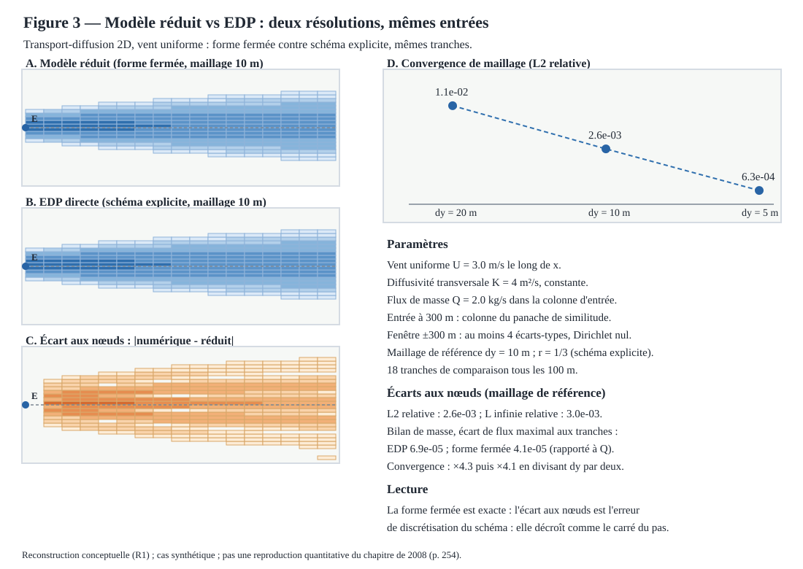

# Figure 3 — Modèle réduit vs EDP : deux résolutions, mêmes entrées



## Statut

**R1 — reconstruction conceptuelle, figure 3 du plan de figures du chapitre de 2008** (cf. [docs/16](16-chapitre-2008-reconstruction-figures.md) et l'issue #57 ; la figure 1 est livrée dans [docs/23](23-figure-01-reconstruction-vent.md), la figure 2 par la PR #60, la figure 4 par la PR #190, la figure 5 par la PR #191). Ce livrable ne reproduit pas la figure du chapitre Springer et ne valide aucune donnée historique : il établit, sur un cas synthétique bien posé, que deux résolutions indépendantes du même problème de transport-diffusion coïncident aux nœuds, à l'erreur de discrétisation près.

Le problème de référence est un transport longue distance 2D horizontal : U ∂C/∂x = K ∂²C/∂y², vent uniforme U = 3 m/s le long de x, diffusivité transversale constante K = 4 m²/s, flux de masse Q = 2 kg/s. L'entrée à x = 300 m est la colonne intégrée en z du panache de similitude : le niveau proche du chapitre fournit la quantité d'entrée. Le domaine court jusqu'à x = 2000 m dans une fenêtre latérale de ±300 m — au moins quatre écarts-types au terme — avec Dirichlet nul aux bords.

Deux résolutions indépendantes partagent exactement ces entrées :

- **modèle réduit** : la forme fermée de similitude, solution exacte du problème de référence à diffusivité constante ;
- **EDP directe** : un schéma FTCS explicite qui avance en x, au nombre de Fourier K dx / (U dy²) = 1/3 exact sur les trois maillages (dy = 20, 10, 5 m).

La comparaison se fait aux nœuds de 18 tranches espacées de 100 m. Au maillage de référence (dy = 10 m), l'écart L2 relatif vaut 2,6 × 10⁻³ et l'écart L infini relatif 3,0 × 10⁻³ ; l'erreur décroît de ×4,3 puis ×4,1 quand le pas transversal est divisé par deux (ordre deux). Le bilan de masse est contrôlé à chaque tranche : l'écart de flux reste sous 6,9 × 10⁻⁵ pour le schéma et 4,1 × 10⁻⁵ pour la forme fermée — la queue tronquée par la fenêtre, documentée comme telle.

## Tranche verticale

Toutes les valeurs affichées proviennent de la tranche typée `jdriftx.experiences.modele_reduit_edp` :

- `ScenarioComparaisonEDP` : vent, diffusivité, débit, distances d'entrée et de fin, demi-largeur, pas transversal de référence et pas de tranche — tous validés à la construction (multiples exacts, fenêtre d'au moins quatre écarts-types, divisibilité des trois maillages) ;
- `concentration_reduite` : colonne intégrée en z du panache de similitude, forme fermée, nulle en amont ;
- `resoudre_edp` : schéma FTCS explicite avec Dirichlet nul, renvoie les tranches de comparaison — champs numérique et réduit aux mêmes nœuds, de l'entrée au terme ;
- `comparer_scenario` : normes L2 et L infinie relatives, rapports de convergence entre maillages successifs, écarts de flux maximaux, concentration maximale aux nœuds ;
- `construire_manifeste` / `ManifesteComparaisonEDP.vers_dict` : export JSON reproductible, niveau R1, commande `uv run` incluse.

## Génération, manifeste et tests

Le SVG se régénère depuis la tranche :

```bash
uv run python -c 'from pathlib import Path; from jdriftx.figures.figure_03 import render_figure_03_svg; Path("site/images/figure-03-modele-reduit-edp.svg").write_text(render_figure_03_svg(), encoding="utf-8")'
```

Les tests de la tranche et du rendu :

```bash
uv run pytest tests/test_modele_reduit_edp.py tests/test_figure_03.py -q
```

Les tests couvrent : les invariants du scénario (paramètres positifs, multiples exacts, fenêtre, divisibilité des maillages), la forme fermée analytique (pic transversal, croissance en racine carrée de l'écart-type), la coïncidence exacte des deux routes à l'entrée, la symétrie du champ numérique, le Dirichlet nul aux bords, les normes reproductibles et la convergence d'ordre deux, le manifeste et son export JSON, la sortie SVG (bien formée, déterministe, valeurs issues de la tranche) et la synchronisation de la copie versionnée avec le générateur. La copie versionnée du SVG doit rester strictement synchronisée avec la sortie du module : le test d'égalité octet par octet échoue sinon.

## Référence

Brun, J.-M. & Mohammadi, B. (2008), « Reduced-Order Modelling of Dispersion », chapitre 14, p. 254, DOI 10.1007/978-1-4020-8758-5_14 : source du plan de figures. Ce livrable n'utilise ni sa géométrie ni ses paramètres : c'est un objet de vérification conceptuel, niveau R1, sans prétention quantitative.
