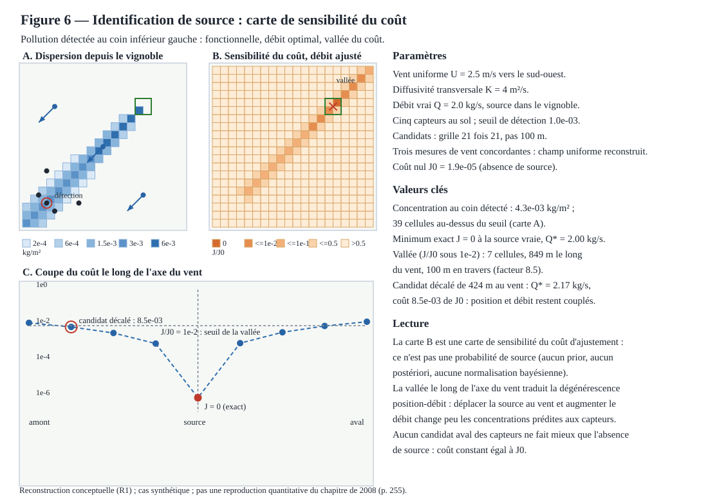

# Figure 6 — Identification de source : sensibilité du coût



## Statut

**R1 — reconstruction conceptuelle, figure 6 du plan de figures du chapitre de 2008** (cf. [docs/16](16-chapitre-2008-reconstruction-figures.md) et l'issue #57 ; la figure 1 est livrée dans [docs/23](23-figure-01-reconstruction-vent.md), la figure 2 par la PR #60, la figure 3 dans [docs/35](35-figure-03-modele-reduit-edp.md), la figure 4 par la PR #190, la figure 5 par la PR #191). Ce livrable ne reproduit pas la figure du chapitre Springer et ne valide aucune donnée historique : il établit, sur un cas synthétique bien posé, ce qu'une séquence de détection peut et ne peut pas identifier.

Le scénario est un problème inverse minimal : une pollution est détectée au coin inférieur gauche du domaine, et il faut localiser sa source. Le vent est reconstruit uniforme à partir de trois mesures concordantes — U = 2,5 m/s vers le sud-ouest —, la diffusivité transversale vaut K = 4 m²/s, et la source synthétique (position (1500, 1500) m, débit Q = 2 kg/s) est cachée dans un vignoble de 200 m de côté. Cinq capteurs au sol sont posés dans la fenêtre de calcul (2000 × 2000 m) ; un seul dépasse le seuil de détection de 1,0 × 10⁻³ kg/m², avec une concentration de 4,3 × 10⁻³ kg/m² — 39 cellules de la carte dépassent le seuil.

## Problème direct et problème inverse

Toutes les valeurs affichées proviennent du module typé `jdriftx.experiences.identification_source` :

- **problème direct** : un panache de similitude intégré en z, nul en amont, à traversée gaussienne d'écart-type √(2Kx'/U) le long de l'axe du vent. `concentration(scenario, point, source, debit)` est exactement linéaire en débit ;
- **fonctionnelle** : le coût J(p) somme les écarts quadratiques aux cinq capteurs, rapportés au coût nul J0 = 1,9 × 10⁻⁵ (l'absence de source, somme des carrés observés) ;
- **débit optimal** : pour chaque position candidate, Q* est obtenu en forme fermée par moindres carrés, grâce à la linéarité exacte en débit ;
- `resoudre_scenario` : balaye la grille des candidats (21 × 21 nœuds, pas 100 m), renvoie la carte des coûts minimaux, la vallée du coût, le candidat décalé et le manifeste ;
- `construire_manifeste` / `ManifesteIdentification.vers_dict` : export JSON reproductible, niveau R1, commande `uv run` incluse.

Les observations étant sans bruit, le minimum est exact : J = 0 à la source vraie, position (1500, 1500) m et débit Q* = 2,00 kg/s retrouvés exactement.

## Carte de sensibilité et non-identifiabilité

La carte B est une **carte de sensibilité du coût d'ajustement, pas une probabilité de source** : aucun prior, aucun postériori, aucune normalisation bayésienne. Elle porte deux signatures lisibles :

- une **vallée allongée le long de l'axe du vent** : 7 cellules sous le seuil relatif J/J0 <= 1e-2, étendue de 849 m dans le sens du vent pour 100 m en travers (facteur 8,5). La dégénérescence position-débit est la non-identifiabilité dominante : déplacer la source au vent et augmenter le débit change peu les concentrations prédites aux capteurs ;
- un **candidat décalé de 424 m au vent** atteint Q* = 2,17 kg/s pour un coût relatif de 8,5 × 10⁻³ de J0 — une ambiguïté réelle, chiffrée plutôt que niée.

Aucun candidat aval des capteurs ne fait mieux que l'absence de source : le coût y est constant, égal à J0.

## Génération, manifeste et tests

Le SVG se régénère depuis le module :

```bash
uv run python -c 'from pathlib import Path; from jdriftx.figures.figure_06 import render_figure_06_svg; Path("site/images/figure-06-identification-source.svg").write_text(render_figure_06_svg(), encoding="utf-8")'
```

Les tests du module et du rendu :

```bash
uv run pytest tests/test_identification_source.py tests/test_figure_06.py -q
```

Les tests couvrent : les invariants du scénario (vent non nul, exactement cinq capteurs distincts, indice de détection, seuil dépassé par le seul capteur de détection, pavage exact de la fenêtre, candidat décalé sur la grille et strictement amont), la nullité en amont et la symétrie transversale du panache, la linéarité exacte en débit, la récupération exacte de la position et du débit, la vallée étroite et allongée, l'ambiguïté chiffrée du candidat décalé, le manifeste et son export JSON, la sortie SVG (bien formée, déterministe, valeurs issues du résultat, densité des cartes) et la synchronisation de la copie versionnée avec le générateur. La copie versionnée du SVG doit rester strictement synchronisée : le test d'égalité octet par octet échoue sinon.

Avec cette note, les six figures du plan du chapitre de 2008 sont livrées.

## Référence

Brun, J.-M. & Mohammadi, B. (2008), « Reduced-Order Modelling of Dispersion », chapitre 14, p. 255, DOI 10.1007/978-1-4020-8758-5_14 : source du plan de figures. Ce livrable n'utilise ni sa géométrie ni ses paramètres : c'est un objet de vérification conceptuel, niveau R1, sans prétention quantitative.
