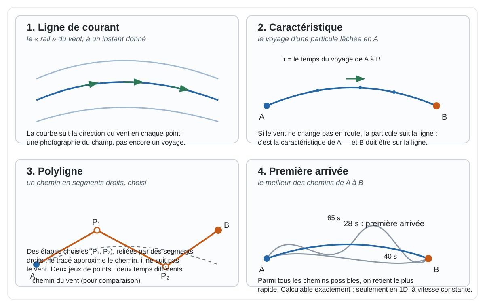

# Glossaire — les notions en français simple

Le vocabulaire de la dispersion atmosphérique et de la modélisation réduite, expliqué en quelques phrases. Chaque terme indique **d'où il vient** et renvoie vers la page du site qui le développe. Les symboles et notations sont en tête de page.

## Notations et symboles

Les notations employées sur la page d'accueil et ses schémas ($C(x,y,z)$, $\tau$, $Q$, $h$…). Chaque ligne renvoie vers la page qui définit et utilise le symbole.

| Symbole | Signification | Unité | Défini et utilisé sur |
|---|---|---|---|
| $C(x, y, z)$ | concentration du scalaire passif au point $(x, y, z)$ — la grandeur que le modèle calcule en tout point | g/m³ | [Similitude](theorie/similitude.qmd), [Modèle direct](theorie/modele-direct.qmd) |
| $(x, y, z)$ | coordonnées du point d'évaluation : $x$ le long du vent (sous le vent), $y$ transversal, $z$ vertical | m | [Similitude](theorie/similitude.qmd) |
| $\tau$ | notation générique à préciser selon la définition retenue : temps sur un chemin imposé, temps de première arrivée, ou temps jusqu'à une projection dans la construction historique. Ces objets peuvent différer ; le symbole seul ne définit pas l'algorithme. | s pour les variantes temporelles | [Métrique travel-time](theorie/metrique-travel-time.qmd) |
| $\tau(A\to B)$ | temps de parcours dirigé selon une construction précisée ; l'intégrale sur une trajectoire fixée, le temps minimal et la pseudo-distance projetée sont des objets distincts, avec des statuts d'implémentation différents | s (si temps) | [Définitions et correspondance avec le code](theorie/metrique-travel-time.qmd#correspondance-avec-le-code-actuel) |
| iso-$\tau$ | courbes ou surfaces reliant les points à temps de transport égal depuis la source | — | [Métrique travel-time](theorie/metrique-travel-time.qmd) |
| $Q$ | débit d'émission de la source continue ; la conservation de la masse impose au panache de le restituer à travers toute surface iso-$\tau$ | kg/s | [Similitude](theorie/similitude.qmd), [Contraintes physiques](theorie/contraintes-physiques.qmd) |
| $h$ | hauteur de la source au-dessus du sol ; les termes $(z-h)$ et $(z+h)$ encodent la réflexion au sol | m | [Similitude](theorie/similitude.qmd) |
| $M$ | masse totale émise par un puff (rejet instantané) | kg | [Similitude](theorie/similitude.qmd) |
| $\mathbf u$, $u(z)$ | champ de vent ; $u(z)$ désigne son profil vertical (cisaillé) | m/s | [Modèle direct](theorie/modele-direct.qmd) |
| $U$ | vitesse du vent, supposée uniforme dans la formule gaussienne | m/s | [Similitude](theorie/similitude.qmd) |
| $\sigma_y(x)$, $\sigma_z(x)$ | écarts-types de dispersion latérale et verticale du panache, fonctions de la distance sous le vent et de la classe de stabilité | m | [Similitude](theorie/similitude.qmd) |
| $\mathbf K$ | tenseur de diffusion turbulente (fermeture gradient, « K-théorie ») | m²/s | [Modèle direct](theorie/modele-direct.qmd) |
| $\nabla\cdot\mathbf u = 0$ | divergence nulle du vent : incompressibilité, héritée par le modèle réduit | — | [Contraintes physiques](theorie/contraintes-physiques.qmd) |
| $\Sigma_\tau$ | surface iso-temps de transport, traversée par le flux conservé $Q$ | — | [Contraintes physiques](theorie/contraintes-physiques.qmd) |
| $(\tau, n_1, n_2)$ | coordonnées travel-time : temps de transport et deux coordonnées normales | s, m | [Métrique travel-time](theorie/metrique-travel-time.qmd) |
| $B^\perp$ | projection du point cible $B$ sur la ligne de courant issue de $A$ (pseudo-distance historique) | — | [Métrique travel-time](theorie/metrique-travel-time.qmd) |
| $\theta$ | vecteur des paramètres libres du modèle approché, calibrés par assimilation | — | [Assimilation & identification](theorie/assimilation-identification.qmd) |
| $v(p)$, $V(p)$ | modèle approché (évaluation à coût réduit) / modèle direct (calcul complet de l'état) | — | [Réduction a priori](theorie/reduction-a-priori.qmd) |

## Dispersion et pollution

**Scalaire passif.** Une substance transportée par l'air **sans le modifier** : elle ne change pas le vent, ne réagit pas chimiquement. Un pesticide en suspension est traité comme un scalaire passif. *Origine* : notion classique de la mécanique des fluides turbulentes, où l'on étudie le mélange de « traceurs passifs ». → [Modèle direct](theorie/modele-direct.qmd)

**Panache (plume).** La traînée allongée laissée par une source **continue** (une cheminée qui émet en permanence). *Origine* : vocabulaire standard de la dispersion atmosphérique. → [Solutions de similitude](theorie/similitude.qmd)

**Panache gaussien généralisé.** Terme propre à Drift-X [@mohammadi2006crmeca; @brun2008] : le panache gaussien classique — construit pour un vent uniforme sur terrain plat — **réexprimé dans la métrique des temps de transport**, la distance sous le vent $x$ étant remplacée par le temps $\tau$. La même forme de similitude, transportée dans la géométrie du vent réel (cisaillé, en terrain suivi). La portée exacte de cette généralisation fait l'objet de la [revue mathématique](etat-art/revue-mathematique.qmd). → [Similitude](theorie/similitude.qmd) et [Métrique travel-time](theorie/metrique-travel-time.qmd)

**Puff.** Une « bouffée » : la traînée d'une émission **brève et localisée** dans le temps (déversement accidentel). → [Solutions de similitude](theorie/similitude.qmd)

**Dérive de pulvérisation (spray drift).** La part d'un pesticide pulvérisé qui n'atteint pas la cible et part dans l'air — l'application historique de Drift-X, en viticulture, de la parcelle au bassin versant.

**Near-field / far-field.** Le champ proche (près de la buse ou de la source : l'émission et sa distribution immédiate) et le champ lointain (le transport sur de grandes distances). Le modèle Drift-X couple les deux : le champ proche fournit les conditions d'entrée du transport. *Origine* : vocabulaire de l'évaluation des expositions et de la réglementation de la dérive de pulvérisation. → [Panorama](etat-art/panorama.qmd)

**Concentration.** Quantité de substance par volume d'air (typiquement en g/m³). C'est la grandeur que le modèle calcule en tout point — notée $C$.

## Similitude et métrique

**Solution de similitude.** Une forme **déjà connue** de la physique pour les jets et panaches : le profil de concentration suit des lois universelles (l'épaisseur suit des lois de croissance en puissance, différentes selon le régime, laminaire ou turbulent). Plutôt que de tout recalculer, on **part de ces formes**. *Origine* : mécanique des fluides des jets et panaches, fondée sur l'auto-similarité des profils transversaux. → [Solutions de similitude](theorie/similitude.qmd)

**Temps de transport et pseudo-distance dirigée (τ).** Plusieurs objets doivent être distingués : (1) l'intégrale du temps le long d'une trajectoire spécifiée ; (2) le temps minimal lorsque la trajectoire est optimisée ; (3) la construction historique attribuée à Drift-X, qui projette le point cible sur une ligne de courant issue du point de départ pour définir une pseudo-distance. Ces objets ne sont pas interchangeables et leurs propriétés dépendent de la définition, du champ de vitesse et des conventions d'accessibilité. Une intégrale sur une même courbe ne devient pas asymétrique par sa seule écriture. La définition historique exacte et ses antécédents restent à vérifier dans la [revue mathématique](etat-art/revue-mathematique.qmd). *Origine revendiquée* : corpus Drift-X (C. R. Mécanique 2006, chapitre Springer 2008). → [Métrique travel-time](theorie/metrique-travel-time.qmd)

**Non-symétrie.** Une fonction de coût dirigée peut vérifier $\tau(A\to B)\ne\tau(B\to A)$, mais cette propriété n'est pas automatique pour toute intégrale de temps de parcours. Dans le code, [`temps_transport`](https://github.com/JM-Brun/J-DriftX/blob/main/src/jdriftx/metric.py) utilise les normes et est donc insensible au signe du vent ; [`pseudo_distance_uniforme`](https://github.com/JM-Brun/J-DriftX/blob/main/src/jdriftx/metric.py) applique en champ uniforme une convention locale de coût amont $+\infty$ et ignore le décalage transversal. Les tests associés sont dans [`tests/test_metric.py`](https://github.com/JM-Brun/J-DriftX/blob/main/tests/test_metric.py). Ces comportements ne constituent pas une implémentation générale en champ variable ni une preuve de fidélité historique. Voir la [comparaison détaillée entre définitions et code](theorie/metrique-travel-time.qmd#correspondance-avec-le-code-actuel) et la [revue mathématique](etat-art/revue-mathematique.qmd).

**Métrique riemannienne.** La façon « classique » de mesurer les longueurs dans un espace courbe : au voisinage de chaque point, une règle (produit scalaire) **symétrique et réversible**. La distance euclidienne en est le cas plat : la boule unité est un cercle. → [Métriques non riemanniennes](theorie/metriques-non-riemanniennes.qmd)

**Métrique non riemannienne.** Toute métrique qui abandonne un axiome du cadre riemannien : la symétrie (**quasi-métrique** : aller ≠ revenir), l'indépendance directionnelle (**Finsler** : la longueur dépend du sens de parcours), ou le plan lui-même (**distance-temps** mesurée sur un réseau). La construction visée pour τ cumule ces ruptures — son statut exact (pseudo-distance, quasi-distance) est suivi par la [revue mathématique](etat-art/revue-mathematique.qmd). → [Métriques non riemanniennes](theorie/metriques-non-riemanniennes.qmd)

**Distance-temps.** Distance mesurée en **temps de parcours** — sur un réseau de transport (géographie humaine, Muller 1979) ou dans un champ de vent (Drift-X). C'est la distance « vécue » par le voyageur ou le polluant, pas celle mesurée au sol. *Origine* : cartographie des distances-temps en géographie [@muller1979persee]. → [Métriques non riemanniennes](theorie/metriques-non-riemanniennes.qmd)

**Isochrone.** Courbe reliant les points à temps de parcours égal d'une source ; les courbes **iso-τ** du modèle en sont l'analogue advectif. Les cartes en isochrones et les anamorphoses déforment la carte pour respecter la métrique.

**Finsler / Zermelo.** Le problème de navigation de **Zermelo** cherche le trajet le plus rapide d'un mobile qui peut choisir sa commande dans un courant ; sous des hypothèses précises, ce problème peut être représenté par une métrique de type Randers, dans le cadre plus général de la géométrie de Finsler. Cela ne rend pas automatiquement ce problème équivalent au transport d'un traceur passif soumis à un champ de vitesse prescrit : la dynamique et les trajectoires admissibles diffèrent. Finsler/Zermelo constitue donc un antécédent mathématique à comparer, pas à lui seul une justification de la métrique de Drift-X. *Origine* : géométrie différentielle et calcul des variations. → [Métriques non riemanniennes](theorie/metriques-non-riemanniennes.qmd) et [Revue mathématique](etat-art/revue-mathematique.qmd)

**Classes de Pasquill.** Six classes de stabilité atmosphérique, de A (très instable) à F (très stable), qui pilotent la croissance des $\sigma_y$, $\sigma_z$ avec la distance. *Origine* : F. Pasquill (1961), complétées par les courbes de Gifford et les formules de Briggs (1973) utilisées par les modèles réglementaires. → [Similitude](theorie/similitude.qmd)

**Champ stationnaire.** Un champ de vitesse qui ne dépend pas du temps : $\mathbf u(\mathbf x)$, et non $\mathbf u(\mathbf x, t)$. La ligne de courant issue d'un point est alors une courbe fixe, et la particule lâchée en ce point la suit : ligne de courant et trajectoire coïncident. *Quasi-stationnaire* (hypothèse [H3](../hypotheses/catalogue.qmd)) : le champ est traité comme stationnaire pendant la durée d'un transport, même s'il évolue ensuite. → [Métrique travel-time](theorie/metrique-travel-time.qmd)

**Topographie et MNT (DEM).** Le modèle numérique de terrain : l'altitude du sol en chaque point. Le MNT donne la normale au sol, utilisée pour « coller » le panache au relief. Le multi-niveaux permet de charger le MNT à la bonne résolution : grossière au loin, fine près des zones d'intérêt.

## Chemins, lignes et temps de transport

Quatre notions géométriques pour comprendre la métrique $\tau$, puis deux outils de calcul. **Le code Python du dépôt n'est pas la définition** : il implémente certains de ces concepts, partiellement — chaque fonction citée indique seulement quel concept elle réalise.

**Ligne de courant.** Une courbe qui, en chacun de ses points, est **tangente au champ de vitesse**, prise à un instant fixé : la direction locale du vent, dessinée partout dans le domaine. C'est le chemin naturel du transport — la construction historique suit la ligne de courant issue de la source et y projette le point cible ($B^\perp$). *Limite* : elle est définie à un instant fixé ; elle ne devient le trajet d'une particule que si le champ ne change pas pendant le voyage. → [Métrique travel-time](theorie/metrique-travel-time.qmd)

**Caractéristique.** Le voyage d'une particule : lâchée en $A$, elle suit la ligne de courant — **si le champ est stationnaire**. La définition historique de $\tau$ compte le temps **le long de ce voyage**. *Pourquoi cette distinction est écrite noir sur blanc* : intégrer le temps le long d'une courbe suppose la courbe déjà connue — l'écrire ne dispense pas de la trouver ; et si le champ change en route, le trajet réel quitte la ligne de courant. *Dans le code* : aucun solveur ne calcule les caractéristiques aujourd'hui. → [Métrique travel-time](theorie/metrique-travel-time.qmd)

**Polyligne.** Un chemin décrit par une suite de **points d'étape reliés par des segments droits**. *À quoi ça sert* : approcher n'importe quel chemin avec un simple jeu de points, et additionner des durées de segments. *Limite* : le résultat dépend des points choisis, et le tracé ne suit pas nécessairement le vent — ce n'est ni le trajet d'une particule, ni le chemin le plus rapide. *Dans le code* : `temps_transport(ligne, vent)` calcule le temps de parcours du seul tracé fourni ; elle n'en cherche pas d'autre et ignore le sens du vent.

**Temps de première arrivée.** Parmi **tous les chemins** qui mènent de $A$ à $B$, le temps du plus rapide — par opposition au temps sur un chemin imposé. En 1D, à vitesse constante signée, il se calcule par une formule directe : distance divisée par vitesse, $+\infty$ si la cible est dans le sens contraire du mouvement. *Pourquoi ce cas est précieux* : tout s'y calcule **exactement**, sans approximation numérique, donc tout comportement limite — cible en amont, vitesse nulle — est spécifié et testable à la perfection. *Dans le code* : `temps_premiere_arrivee_1d` implémente exactement ce cas 1D, et rien d'autre.

**Fonction de courant.** En 2D, on peut construire un champ de vitesse à partir d'une fonction $\psi$ par $u=\partial\psi/\partial y$, $v=-\partial\psi/\partial x$. Si $\psi$ est suffisamment régulière pour que les dérivées partielles mixtes coïncident, alors $\nabla\cdot\mathbf u=\partial_x\partial_y\psi-\partial_y\partial_x\psi=0$. L'incompressibilité est garantie par la définition du champ, plutôt que vérifiée après coup. C'est une propriété mathématique du champ construit, pas une garantie de représentativité météorologique. *À quoi ça sert* : les expériences de reconstruction du vent (figure 1) ont besoin de champs synthétiques exactement incompressibles. *Dans le code* : `ChampFonctionCourant` (module `champ_analytique`) et la superposition de tels champs. → [Laboratoire interactif](projet/laboratoire-interactif.qmd) et [expérience figure 1](https://github.com/JM-Brun/J-DriftX/blob/main/docs/23-figure-01-reconstruction-vent.md)

**Formule fermée (formule close).** Une formule qu'on **applique une fois** pour obtenir le résultat exact — sans boucle de calcul, sans approximation numérique ; l'aire d'un cercle, $\pi r^2$, en est l'exemple type. *Pourquoi c'est important ici* : un résultat en formule fermée se vérifie à la perfection (le test compare le calcul à la formule), alors qu'un résultat d'itération numérique n'est connu qu'avec une précision. Les références exactes du projet (première arrivée 1D, pseudo-distance en champ uniforme) sont précieuses pour cette raison.

Les contrats précis de chaque fonction — hypothèses, comportements et tests — sont détaillés dans la [correspondance avec le code](theorie/metrique-travel-time.qmd#correspondance-avec-le-code-actuel) ; l'investigation mathématique des définitions, dans l'[investigation G0-S](https://github.com/JM-Brun/J-DriftX/blob/main/docs/19-investigation-g0s-temps-de-parcours.md).

## Réduction de complexité

Cette section décrit l'**approche visée** ; l'état réel de l'implémentation (socle gaussien en vent uniforme, primitive de polyligne pour le coût) est consigné dans le README du dépôt et sur la page [Qualité & tests](projet/qualite.qmd).

**Réduction a priori.** Construire l'espace des solutions possibles **à partir de la physique** (similitude) avant tout calcul — par opposition aux approches a posteriori. → [Réduction a priori](theorie/reduction-a-priori.qmd)

**ROM (modèle d'ordre réduit).** Famille de méthodes qui remplacent une simulation complète par un calcul en petit nombre de dimensions. Les ROM classiques (POD…) commencent par calculer de nombreux *snapshots* d'une simulation complète — ce que Drift-X évite. *Origine* : réduction de modèle du calcul scientifique ; la POD (décomposition orthogonale propre) a été introduite dans l'étude de la turbulence, puis diffusée comme méthode de réduction générique. → [Réduction a priori](theorie/reduction-a-priori.qmd) et [Comparaison des complexités](theorie/comparaison-complexites.qmd)

**Snapshot.** Une solution complète précalculée d'un modèle coûteux (typiquement CFD), utilisée comme brique de base des ROM classiques. Drift-X n'en utilise pas : c'est sa différence structurelle.

**EDP (équation aux dérivées partielles).** Équation reliant les variations de la concentration en espace et en temps (advection–diffusion) ; sa résolution numérique exige un maillage et un schéma. → [EDP & maillage](theorie/edp-et-maillage.qmd)

**Maillage.** Discrétisation du domaine en cellules sur laquelle une EDP peut être résolue numériquement ; sa taille gouverne le coût de la simulation. → [EDP & maillage](theorie/edp-et-maillage.qmd)

**CFD (mécanique des fluides numérique).** Résolution numérique des équations de l'écoulement (RANS, LES) sur un maillage : la « modélisation complète » du problème — référence de précision et de coût, dont les snapshots alimentent les ROM, et que J-DriftX cherche à éviter pour ses usages. → [EDP & maillage](theorie/edp-et-maillage.qmd) et [Comparaison des complexités](theorie/comparaison-complexites.qmd)

**Sans EDP, sans maillage.** Le modèle n'estime pas la solution d'équations aux dérivées partielles sur un maillage (grille de calcul) ; il **évalue une formule** en chaque point demandé. → [Modèle direct](theorie/modele-direct.qmd) et [EDP & maillage](theorie/edp-et-maillage.qmd)

**Évaluation ponctuelle.** Capacité visée : donner la concentration en **un seul point**, sans calculer le champ entier. C'est ce qui rendrait le coût marginal quasi nul — et Monte Carlo massif abordable. → [Métrique travel-time](theorie/metrique-travel-time.qmd)

**Multi-niveaux.** Domaines rectangulaires emboîtés (typiquement 3, de ~10 km² à ~10 m²), chaque niveau affinant le précédent par interpolation aux 4 coins. La construction **historique** garantissait divergence nulle du vent et conservation de la masse ; la reprise doit la reconstruire et la tester ([Contraintes physiques](theorie/contraintes-physiques.qmd)). → [Réduction a priori](theorie/reduction-a-priori.qmd)

## Contraintes et calibration

**Contraintes physiques.** Le contrat de confiance du modèle : conservation de la masse, positivité des concentrations, superposition (linéarité), divergence nulle du vent généré. Le modèle approché doit rester solution du modèle direct ; la page dédiée distingue ce qui est **formulé**, **testé** ou **démontré**. → [Contraintes physiques](theorie/contraintes-physiques.qmd)

**Divergence nulle.** Le vent généré ne « crée » ni ne « détruit » d'air : c'est la condition d'incompressibilité, conservée par construction dans le prototype historique multi-niveaux ; non implémentée ni testée dans la reprise ([Contraintes physiques](theorie/contraintes-physiques.qmd)).

**Assimilation de données.** Régler les paramètres du modèle (a, b, …) sur les **mesures disponibles, même partielles** — quelques points de mesure suffisent, pas besoin d'un champ complet. *Origine* : géophysique prévisionniste — météorologie et océanographie (filtre de Kalman, méthodes variationnelles de type 4D-Var). → [Assimilation & identification](theorie/assimilation-identification.qmd)

**Analyse de sensibilité.** Mesurer comment la sortie varie quand un paramètre bouge. Dans l'objectif Drift-X, l'adjoint serait **analytique, donc quasi gratuit** : double usage, analyse de risque et identification de source — capacité non encore établie. → [Assimilation & identification](theorie/assimilation-identification.qmd)

**Identification de source (problème inverse).** À partir de concentrations mesurées, retrouver **d'où vient** la pollution : position, intensité, date de la source. L'autre face de l'analyse de sensibilité.

**Adjoint.** Outil mathématique donnant la sensibilité de la sortie à tous les paramètres d'un coup. Dans Drift-X historique, il était construit par différentiation automatique (l'outil INRIA Tapenade) à coût indépendant du nombre de paramètres ; la reprise vise un adjoint analytique, dérivé de la formule fermée — capacité non encore établie.

## Outils et logiciel

**SIG (système d'information géographique).** Logiciel de gestion et de cartographie des données localisées. Le prototype historique était un plugin **QGIS** (open source) autour d'un cœur Fortran échangeant par fichiers CSV.

**GDAL.** Bibliothèque open source de traitement des données géographiques — extraction du MNT, interpolation en raster. Le prototype l'utilisait déjà ; la future couche SIG de J-DriftX s'appuiera sur ses équivalents modernes.

**AGDISP.** Modèle de référence de la dérive de pulvérisation aux États-Unis, utilisé par les régulateurs ; son extension gaussienne couvre le far-field. Sa réécriture open source (**AGDISP Modernization Project**, 2023–2026), portée par l'industrie agricole, porte l'effort sur le near-field et le 3D ; le far-field réaliste — cible historique de Drift-X — n'est pas l'objet annoncé (le [panorama](etat-art/panorama.qmd) nuance ce constat). → [Panorama](etat-art/panorama.qmd)

**Jalons de la feuille de route (M0–M3).** Les repères d'avancement du projet, cités sur ce site sous la forme « objectif M2 », « extension v2 (M3) »… : **M0** — ancrage documentaire (retrouver et vérifier les sources primaires) ; **M1** — benchmark gaussien : comparer J-DriftX au modèle gaussien classique (→ [Qualité & tests](projet/qualite.qmd)) ; **M2** — estimateur d'erreur du modèle réduit (→ [Réduction a priori](theorie/reduction-a-priori.qmd)) ; **M3** — calibration bayésienne quantifiant les incertitudes (→ [Assimilation & identification](theorie/assimilation-identification.qmd)). Ce sont des étapes planifiées, citées pour situer les travaux à venir.

**Benchmark gaussien.** Le premier jalon de validation (M1 de la feuille de route) : comparer J-DriftX au modèle gaussien classique, la référence de la discipline. → [Qualité & tests](projet/qualite.qmd)

---

Une notion manquante ou obscure ? Ouvrez une [issue](https://github.com/JM-Brun/J-DriftX/issues) ou relisez les fiches détaillées : [Lectures des sources](projet/lectures.qmd) (annexe).
