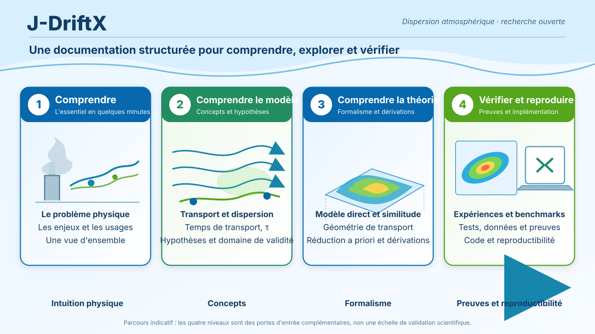

# J-DriftX

**Modéliser la dispersion atmosphérique autrement — et vérifier si cela apporte réellement quelque chose.**

J-DriftX est un projet de recherche open source consacré à la modélisation à complexité réduite de la dispersion atmosphérique de scalaires passifs. Il reprend et modernise le projet historique Drift-X (2006–2009).

> **Où en est-on ?** Le projet étudie l'hypothèse qu'une représentation fondée sur des solutions de similitude et des temps de transport dirigés puisse réduire le coût de certaines évaluations. Sa validité en vent non uniforme, son coût total et son intérêt prédictif ou applicatif **ne sont pas encore établis**. Il s'agit d'une hypothèse de recherche, pas d'un modèle opérationnel validé.

## Le projet en quatre étapes

Cette documentation permet de passer de l'intuition physique aux preuves, sans imposer une lecture linéaire. Choisissez le niveau utile à votre question.

::: {.columns}
::: {.column width="50%"}
**1 · Comprendre**

Le problème étudié, l'origine du projet et ce qui est — ou non — acquis.

[Vue d'ensemble et question de recherche](projet/carte-articulation.qmd)
:::
::: {.column width="50%"}
**2 · Comprendre le modèle**

Les grandeurs physiques et leur enchaînement : vent, transport, dispersion, concentration.

[Carte des niveaux de modélisation](projet/niveaux-modelisation.qmd)
:::
::: {.column width="50%"}
**3 · Comprendre la théorie**

Les équations, les hypothèses de réduction, les solutions de similitude et la géométrie du transport.

[Commencer par le modèle direct](theorie/modele-direct.qmd)
:::
::: {.column width="50%"}
**4 · Vérifier et reproduire**

Les propriétés démontrées ou testées, les expériences, les comparaisons et leurs limites.

[Registre des preuves](projet/registre-preuves.qmd)
:::
:::

## Ce que J-DriftX cherche à comprendre

La question centrale est de savoir si certains problèmes de dispersion peuvent être représentés par une famille de solutions guidée par la physique, puis évalués ponctuellement, sans résoudre à chaque requête une EDP sur un maillage complet.

Trois sujets sont liés, mais doivent rester distincts :

- **La physique de la dispersion** : quelles hypothèses relient le champ de vent, le transport, l'étalement du scalaire et la concentration ? [Voir la chaîne de modélisation](projet/niveaux-modelisation.qmd).
- **La représentation mathématique** : comment passer d'une solution de similitude en vent uniforme à une construction utilisant un temps de transport dirigé ? Cette généralisation est une construction à justifier, pas une conséquence automatique du cas uniforme. [Explorer le temps de transport](theorie/metrique-travel-time.qmd).
- **La valeur scientifique et pratique** : les propriétés physiques, l'erreur, le coût de préparation et d'évaluation, et l'intérêt face à des méthodes de référence doivent être mesurés. [Voir le protocole de validation](projet/validation-scientifique.qmd).

Le projet examine notamment la réduction *a priori*, les temps de transport non symétriques, les contraintes physiques (positivité, conservation, superposition) et les possibilités de calibration par données. Ce sont des axes de recherche, pas quatre capacités déjà acquises. Leur formulation et leurs limites sont détaillées dans les pages [Objectifs](projet/objectifs.qmd) et [Contraintes physiques](theorie/contraintes-physiques.qmd).

## Ce que les résultats permettent de conclure

Une définition mathématique, une démonstration sous hypothèses, un test logiciel, une comparaison à une référence et une validation indépendante n'ont pas la même portée.

À ce stade, les expériences synthétiques et les tests ciblés vérifient des cas définis. Ils ne démontrent ni une validité météorologique générale, ni une utilité applicative, ni un gain de performance face à une baseline pertinente. Le cadrage documentaire est avancé ; les preuves différentielles et applicatives restent à construire.

Pour examiner précisément les hypothèses, la portée des tests et les limites de conclusion, consulter le [registre des preuves](projet/registre-preuves.qmd), le [guide de lecture des statuts de preuve](projet/carte-articulation.qmd#statut-affirmation), les [limites du modèle](hypotheses/limites.qmd) et le [positionnement dans l'état de l'art](etat-art/positionnement.qmd).

## Explorer la documentation

Pour accéder directement à une question, un thème ou une ressource sans suivre le parcours de lecture, utiliser l'[index thématique et le répertoire des ressources de la carte d'articulation](projet/carte-articulation.qmd).

Les questions ouvertes, investigations et tâches de validation sont suivies dans les [issues publiques du dépôt](https://github.com/JM-Brun/J-DriftX/issues). Le [README GitHub](https://github.com/JM-Brun/J-DriftX) décrit l'état de l'implémentation logicielle.
