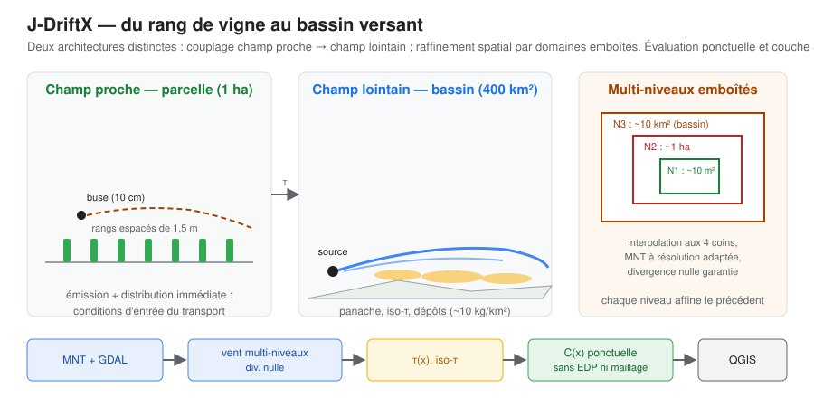

# J-DriftX

**J-DriftX** est un projet de recherche open source sur la **dispersion atmosphérique de scalaires passifs** à très faible coût de calcul. Il est la reprise et la modernisation du projet **Drift-X** développé entre 2006 et 2009 par J.-M. Brun et B. Mohammadi (Cemagref/ITAP et I3M, Montpellier) [@bozon2009driftx; @mohammadi2009gis].

> **Statut scientifique :** hypothèse de recherche en phase de cadrage et de validation. Les propriétés présentées ci-dessous sont des **objectifs de conception**, pas des capacités validées ; le README du dépôt consigne l'état réel de l'implémentation. Voir le [positionnement](etat-art/positionnement.qmd) et la [carte d'articulation](projet/carte-articulation.qmd).

## L'idée en une phrase

Hypothèse étudiée : représenter certains panaches, puffs ou cas de dérive de pulvérisation **sans résoudre directement une EDP ni construire un maillage**, au moyen d'une **évaluation ponctuelle** fondée sur des solutions de similitude et une représentation non symétrique par temps de transport [@mohammadi2006crmeca; @brun2008]. La validité de cette généralisation, son coût total, sa calibration et son avantage prédictif restent à établir ; il ne s'agit pas encore d'une capacité validée.

Les notations de cette page ($C(x,y,z)$, $\tau$, $Q$, $h$…) et les notions employées — scalaire passif, panache gaussien généralisé, solutions de similitude, far-field, Finsler/Zermelo, ROM, assimilation… — sont définies, avec leur origine, dans le [glossaire](glossaire.qmd).

## Quatre propriétés fondatrices (objectifs de conception)

::: {.panel-tabset}

### Réduction *a priori*

L'espace de recherche visé est construit à partir de connaissances physiques (similitude des panaches), plutôt qu'à partir de *snapshots* d'un modèle CFD. L'objectif est une évaluation ponctuelle peu coûteuse ; le coût total, notamment celui du calcul de $\tau$, sa dépendance au domaine et son avantage face à une baseline restent à mesurer.

### Métrique des temps de transport

La coordonnée candidate n'est pas seulement la distance euclidienne : c'est un temps de transport dirigé $\tau$, défini à partir du champ de vent selon une construction qui doit être explicitée. La non-symétrie, le traitement des vents non uniformes et la prise en compte du relief dépendent de la définition retenue et restent à établir pour la généralisation étudiée ([Métrique travel-time](theorie/metrique-travel-time.qmd), [revue mathématique](etat-art/revue-mathematique.qmd)).

### Contraintes physiques imposées

Conservation, positivité, superposition et compatibilité avec un champ de vent incompressible sont des contraintes à préciser pour chaque formulation et domaine de validité. Elles ne signifient pas que le modèle réduit est une solution exacte du modèle direct ; leur statut (formulée, testée, démontrée) est suivi sur la page [Contraintes physiques](theorie/contraintes-physiques.qmd).

### Calibration par données

L'assimilation de données partielles identifie les paramètres ; l'analyse de sensibilité fournit le risque et l'identification de source — l'adjoint visé est analytique, donc quasi gratuit (capacité conditionnelle, non validée).

:::

## Pourquoi maintenant ?

- L'**AGDISP Modernization Project** (2023–2026) réécrit le modèle de dérive en open source en portant l'effort sur le near-field et le 3D ; le **far-field réaliste** — la cible historique de Drift-X — n'est pas l'objet annoncé ([panorama](etat-art/panorama.qmd)).
- De nombreuses ROM classiques et approches *data-driven* s'appuient sur des *snapshots* ou des données d'entraînement, mais ce n'est pas une propriété universelle de toutes les ROM ni de tous les surrogates ML. L'hypothèse d'une réduction *a priori* doit être comparée à des méthodes de référence définies et à coût total équitable ([panorama](etat-art/panorama.qmd)).
- Les données qui manquaient en 2008 (**ERA5/Copernicus, MNT ouverts, capteurs low-cost**) existent désormais.

L'analyse de l'héritage et le panorama de l'état de l'art sont présentés dans les pages scientifiques dédiées. Les notes de pilotage et de décision ne font pas partie du parcours documentaire public.

## Parcours de lecture

Commencer par la [carte d'articulation scientifique](projet/carte-articulation.qmd), qui distingue les sources historiques, l'hypothèse mathématique, les vérifications du code, la comparaison différentielle et la validation indépendante. Le cadrage documentaire G0 est franchi, mais l'utilité applicative (G0-A) reste non démontrée. Les questions ouvertes et les travaux à suivre sont consignés dans les [issues du dépôt](https://github.com/JM-Brun/J-DriftX/issues). Les pages publiques distinguent les fondements scientifiques, les résultats vérifiables et les limites connues.

## De l'idée au détail

Chaque affirmation de haut niveau a sa page de détail — dérivation, justification, limites :

| Question de haut niveau | Où descendre |
|---|---|
| Que disent réellement les sources historiques ? | [Héritage](projet/heritage.qmd) · [Lectures des sources](projet/lectures.qmd) · [Audit de l'héritage](projet/audit.qmd) |
| Pourquoi une métrique de temps de transport, et quels objets mathématiques voisins ? | [Métrique travel-time](theorie/metrique-travel-time.qmd) · [Métriques non riemanniennes](theorie/metriques-non-riemanniennes.qmd) · [Revue mathématique](etat-art/revue-mathematique.qmd) |
| Comment les solutions de similitude sont-elles dérivées ? | [Solutions de similitude](theorie/similitude.qmd) |
| Comment les niveaux physiques, mathématiques et numériques s'articulent-ils ? | [Niveaux de modélisation](projet/niveaux-modelisation.qmd) · [Carte d'articulation](projet/carte-articulation.qmd) · [Carte des connaissances](projet/carte-connaissances.qmd) |
| Que fait exactement le code aujourd'hui — objets, contrats, et pourquoi ? | [Correspondance avec le code](theorie/metrique-travel-time.qmd#correspondance-avec-le-code-actuel) · [Glossaire](glossaire.qmd) · [Qualité & tests](projet/qualite.qmd) |
| Que garantit le modèle, et avec quelles preuves ? | [Contraintes physiques](theorie/contraintes-physiques.qmd) · [Catalogue des hypothèses](hypotheses/catalogue.qmd) · [Limites](hypotheses/limites.qmd) |
| Que coûterait une modélisation complète ? | [EDP & maillage](theorie/edp-et-maillage.qmd) · [Comparaison des complexités](theorie/comparaison-complexites.qmd) |
| Comment les données calibrent-elles le modèle ? | [Assimilation & identification](theorie/assimilation-identification.qmd) |
| Qu'est-ce qui reste à faire et à valider ? | [Limites et domaines de validité](hypotheses/limites.qmd) · [issues du dépôt](https://github.com/JM-Brun/J-DriftX/issues) |

## Explorer

| Entrée | Contenu |
|---|---|
| [Carte d'articulation](projet/carte-articulation.qmd) | Parcours de lecture, niveaux de preuve, état des portes et limites des laboratoires |
| [Carte des connaissances](projet/carte-connaissances.qmd) | Vue relationnelle générée depuis un registre typé : concepts, hypothèses, niveaux, code, tests, références et jeux de données, avec liens cliquables |
| [Niveaux de modélisation](projet/niveaux-modelisation.qmd) | Champ de vent, chemins, temps de transport, dispersion, concentration ; dépendances, hypothèses et état d'implémentation |
| [Le projet](projet/heritage.qmd) | Héritage Drift-X (2006–2009), [objectifs](projet/objectifs.qmd) et [utilité scientifique](projet/utilite-scientifique.qmd) |
| [Fondements théoriques](theorie/modele-direct.qmd) | Modèle direct, réduction a priori, similitude, métrique, contraintes, assimilation — avec les théories mathématiques |
| [EDP & maillage](theorie/edp-et-maillage.qmd) | Ce que serait une modélisation complète du problème : EDP, fermeture de la turbulence, CFD, maillage, schémas numériques, coût |
| [Comparaison des complexités](theorie/comparaison-complexites.qmd) | Où se paie le coût : gaussien, Lagrangien, CFD, ROM a posteriori, ML, réduction a priori — côte à côte |
| [Métriques non riemanniennes](theorie/metriques-non-riemanniennes.qmd) | Distances-temps, quasi-métriques, Finsler/Zermelo : les objets mathématiques voisins de la métrique τ |
| [Qualité & tests](projet/qualite.qmd) | Ce que les tests vérifient réellement — et ce qu'ils ne prouvent pas |
| [Expériences interactives](projet/experiences-interactives.qmd) | Catalogue des expériences, traçabilité propriétés-tests, convergence et exécution locale des outils Streamlit |
| [Hypothèses](hypotheses/catalogue.qmd) | Le catalogue des hypothèses du modèle et leurs limites de validité |
| [État de l'art](etat-art/panorama.qmd) | Ce qui a changé entre 2008 et 2026, et le [positionnement](etat-art/positionnement.qmd) de J-DriftX |
| [Glossaire](glossaire.qmd) | Notations ($C$, $\tau$, $Q$, $h$…) et notions clés (similitude, ROM, assimilation…) expliquées en français simple, avec leur origine |
| [Références](references.qmd) | Bibliographie complète, du corpus historique aux travaux récents |
