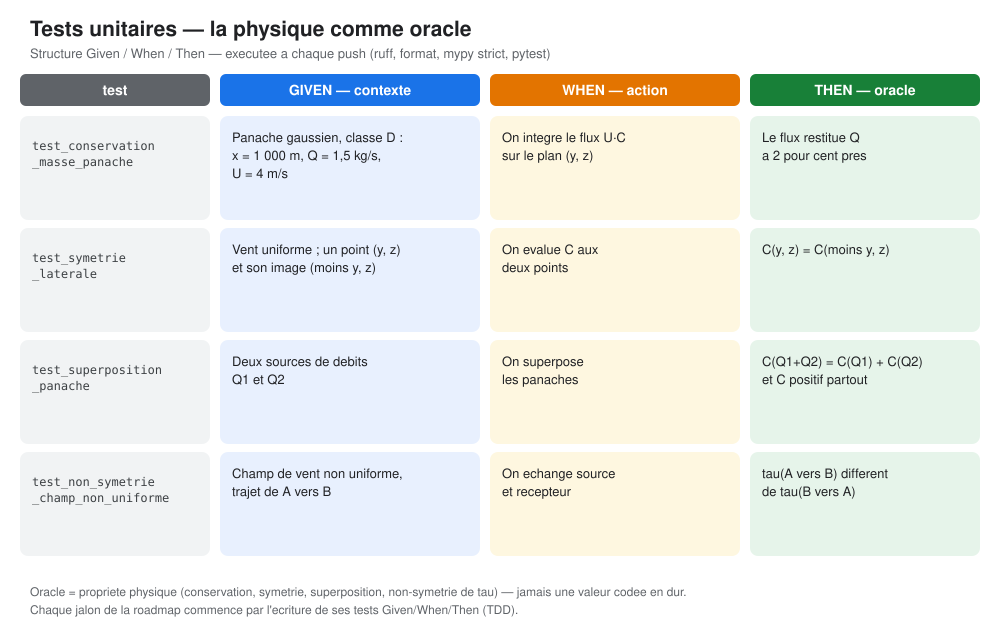

# Qualité et tests : portée réelle des vérifications

Les tests automatisés vérifient des propriétés définies pour des fonctions et des cas précis. Ils ne remplacent ni une preuve mathématique ni une validation physique. Le terme « oracle physique » n'est justifié que si la propriété attendue est correctement formulée, les hypothèses sont explicites et le test représente effectivement cette propriété.

## Tests présents dans le dépôt

| Test existant | Vérification effectuée | Limite à ne pas oublier |
|---|---|---|
| `test_conservation_masse_panache` | Flux `u C` intégré sur une grille finie pour un panache gaussien de classe D ; tolérance relative de 2 % | Un cas, une grille et une tolérance ; ne prouve pas la conservation exacte pour toute surface ou tout modèle |
| `test_positivite_panache` et `test_positivite_puff` | Concentrations non négatives dans les configurations testées | Ne couvre pas tous les paramètres, toutes les interpolations ou des extensions futures |
| `test_superposition_panache` | Superposition du panache à un point et pour deux débits choisis | Ne valide pas tous les couplages ou toutes les extensions multi-sources |
| `test_symetrie_laterale` | Symétrie latérale attendue du panache gaussien en vent uniforme | Propriété de cette formule et de ce régime, pas d'un champ atmosphérique général |
| Tests de `pseudo_distance_uniforme` | Projection longitudinale, coût nul pour certains points distincts, coût infini en amont, invariance par rotation et gestion du vent nul/formes invalides | Référence analytique limitée au vent uniforme ; ne reproduit pas la métrique historique dans un champ variable |
| `test_polyline_cost_is_invariant_to_path_reversal_and_wind_sign` | Confirme que la primitive de polyligne utilise la norme de la vitesse et ignore son orientation | Ce test montre précisément que cette primitive n'est pas la pseudo-distance historique orientée |
| Divergence du champ de vent | Tests ciblés sur les champs analytiques à fonction de courant (différences finies, superposition) et sur la reconstruction à deux mesures (grille, \(< 10^{-12}\ \mathrm{s}^{-1}\)) | Ces tests couvrent des champs de vérification analytiques ; le champ de vent multi-niveaux historique n'est pas implémenté dans le noyau actuel |

## Given / When / Then

Ce format sépare le contexte, l'action et le résultat attendu. Il améliore la lisibilité d'un test, mais ne garantit pas à lui seul que l'oracle est physiquement correct. Pour chaque propriété, la documentation doit indiquer :

1. l'équation ou la définition testée ;
2. les hypothèses et le domaine de validité ;
3. les unités, la discrétisation et la tolérance ;
4. les cas limites et contre-exemples recherchés ;
5. ce que le test ne permet pas de conclure.

## Ce que vérifie la CI

La chaîne CI exécute le rendu Quarto, Ruff (lint et format), mypy et pytest. Ces contrôles détectent des erreurs de compilation documentaire, de style, de typage et des échecs des tests présents. **Ils ne certifient pas l'exactitude scientifique du modèle, ne prouvent pas les propriétés continues et ne couvrent pas automatiquement tous les invariants annoncés.**

Le projet ne doit donc pas annoncer une propriété comme « vérifiée systématiquement » si aucun test ou aucune preuve ne la couvre. En particulier, le statut actuel est :

- **positivité :** quelques cas numériques testés ;
- **superposition :** test ponctuel du panache gaussien ;
- **conservation :** intégrale numérique sur une grille finie, tolérance 2 %, un scénario ;
- **divergence nulle :** testée par des tests ciblés sur les champs analytiques à fonction de courant et sur la reconstruction à deux mesures ; le champ de vent multi-niveaux historique, lui, n'est pas implémenté ;
- **métrique historique :** seule une référence analytique de champ uniforme est testée ; la fonction générale de temps de transport sur polyligne est une primitive distincte.

## Priorités qualité avant le benchmark

1. Étendre le test de conservation en faisant varier l'étendue et le raffinement de la grille, les classes de stabilité, les hauteurs et les débits.
2. Ajouter des tests de convergence et des cas limites indépendants des formules de production.
3. Formaliser la métrique historique et séparer explicitement son API de la primitive de polyligne.
4. Les tests de divergence existants couvrent les champs analytiques à fonction de courant ; pour le champ de vent multi-niveaux historique, ne créer les tests qu'après l'avoir défini et implémenté.
5. Pour chaque jalon, rapporter la couverture réellement obtenue ; ne pas présenter le nombre de tests ou la CI verte comme une preuve de validité scientifique.

Voir la [revue mathématique ciblée](../etat-art/revue-mathematique.qmd), les [contraintes physiques](../theorie/contraintes-physiques.qmd), la [carte d'articulation](carte-articulation.qmd) et l'issue [#42](https://github.com/JM-Brun/J-DriftX/issues/42) (tests des propriétés visées).
