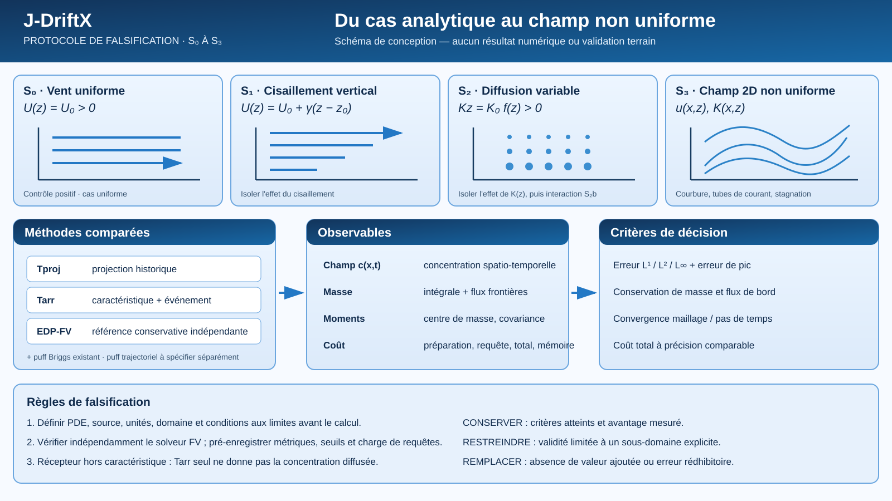

# Validation scientifique et protocole de preuve

Cette page traduit la revue de l’état de l’art en critères de validation pour J-DriftX. Elle distingue le positionnement proposé des résultats qui restent à démontrer.

## Place dans le parcours

Cette page est le **point de décision expérimental** : elle précise quelles observations et comparaisons seraient nécessaires pour soutenir ou réfuter les hypothèses du projet. Elle ne rapporte pas, à elle seule, des résultats de validation.

- **Avant de définir un benchmark :** expliciter les [hypothèses](../hypotheses/catalogue.qmd), les [domaines de validité et limites](../hypotheses/limites.qmd) et le [positionnement dans l’état de l’art](../etat-art/positionnement.qmd).
- **Pour vérifier ce qui est déjà acquis :** confronter chaque affirmation au [registre des preuves](registre-preuves.qmd) et à la portée réelle des [tests logiciels](qualite.qmd).
- **Pour sélectionner des observations :** consulter le [catalogue de données candidates](catalogue-donnees.qmd) ; la présence d’un jeu de données ne vaut ni adéquation physique ni validation indépendante.
- **Pour revenir au modèle :** la [carte des niveaux de modélisation](niveaux-modelisation.qmd) situe les objets N0–N6 concernés par chaque scénario.

Le parcours est donc bidirectionnel : les hypothèses et le modèle déterminent les tests pertinents ; les résultats des tests doivent ensuite conduire à réviser le domaine de validité ou le statut des affirmations, et non à élargir automatiquement les conclusions.

## Statut de la revue

La revue publiée dans le dépôt est une **revue structurée de l’état de l’art**. Elle ne doit être qualifiée de revue systématique reproductible qu’après publication des bases interrogées, requêtes exactes, dates, critères de sélection, nombres de références examinées et méthode d’évaluation de la qualité des sources.

Les conclusions de positionnement — notamment l’absence de concurrents utilisant une métrique *travel-time*, la robustesse hors domaine et l’intérêt pour le *far-field* — sont des hypothèses à instruire, pas des résultats déjà établis. Les affirmations doivent être bornées par les sources réellement consultées.

## Ordre des priorités

1. **M1 — Noyau et référence :** formaliser le domaine de validité, établir un cas gaussien reproductible et automatiser les tests physiques.
2. **M2 — Calibration et problème inverse :** séparer calibration et validation, puis mesurer l’effet du bruit, des données manquantes et de la régularisation.
3. **M3 — Terrain :** utiliser des campagnes publiées avec un jeu de validation indépendant et analyser les incertitudes.
4. **Publication scientifique (hors numérotation M0–M3) :** envisager une synthèse seulement après que les critères de validation applicables sont satisfaits ; présenter les limites, incertitudes et résultats négatifs. Cette étape de diffusion n'est pas définie ici comme un jalon M4, car la feuille de route documentée dans le glossaire ne formalise que M0–M3.

## Protocole de falsification S0–S3

Le schéma suivant présente les scénarios synthétiques à instruire, les méthodes comparées, les observables et les critères de décision. Il s’agit d’un **protocole proposé**, pas d’un résultat expérimental. Les cas S0 uniformes restent suivis par [#232](https://github.com/JM-Brun/J-DriftX/issues/232) et [#244](https://github.com/JM-Brun/J-DriftX/issues/244) ; les extensions S1–S3 sont soumises à des contrats et expériences distincts.

{#fig-protocole-falsification-s0-s3 fig-cap="Protocole expérimental proposé pour confronter les formulations de J-DriftX à une référence indépendante et aux modèles de puffs."}

Le protocole détaillé, incluant l’équation conservative, les conditions de référence, les limites de $T_{\\mathrm{arr}}$, les métriques, le pré-enregistrement et les règles de décision, est décrit dans [la note 60](https://github.com/JM-Brun/J-DriftX/blob/main/docs/60-protocole-falsification-s0-s3.md).

## Critères minimaux d’un benchmark

- Données, hypothèses, unités, paramètres et provenance explicites.
- Baselines définies et protocole de comparaison équitable.
- Erreurs absolue et relative, conservation de masse et positivité lorsque pertinentes.
- Temps de calcul, mémoire, sensibilité et incertitude.
- Version du code, scripts de reproduction et limites de généralisation.

## Règles de formulation

- Dire « objectif de conservation » ou « propriété à démontrer » tant que preuve ou test concluant n’est pas disponible.
- Ne pas revendiquer de supériorité générale sur les modèles réglementaires, ROM ou ML sans comparaison indépendante.
- Présenter J-DriftX comme un prototype de recherche en validation, non comme un substitut réglementaire qualifié.
- Garder le statut des jalons cohérent entre cette page, les objectifs et la feuille de route.

Le protocole public de validation est maintenu dans [docs/05-plan-validation-et-integration.md](https://github.com/JM-Brun/J-DriftX/blob/main/docs/05-plan-validation-et-integration.md). Les plans de travail détaillés et le suivi opérationnel des décisions restent dans les notes privées du projet.

**État des preuves du MVP-S.** Le protocole ci-dessus définit les critères à satisfaire ; il ne constitue pas en lui-même une validation. La [matrice de traçabilité MVP-S](https://github.com/JM-Brun/J-DriftX/blob/main/docs/27-matrice-tracabilite-mvp-s.md) répertorie les définitions, hypothèses, démonstrations, fonctions, tests et limites actuellement documentés.
