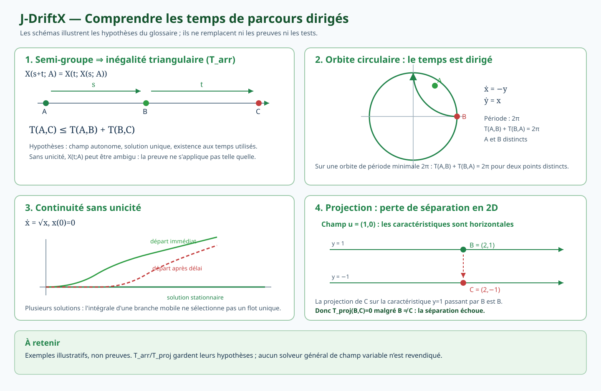
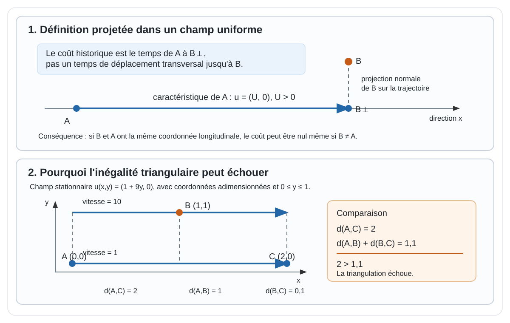
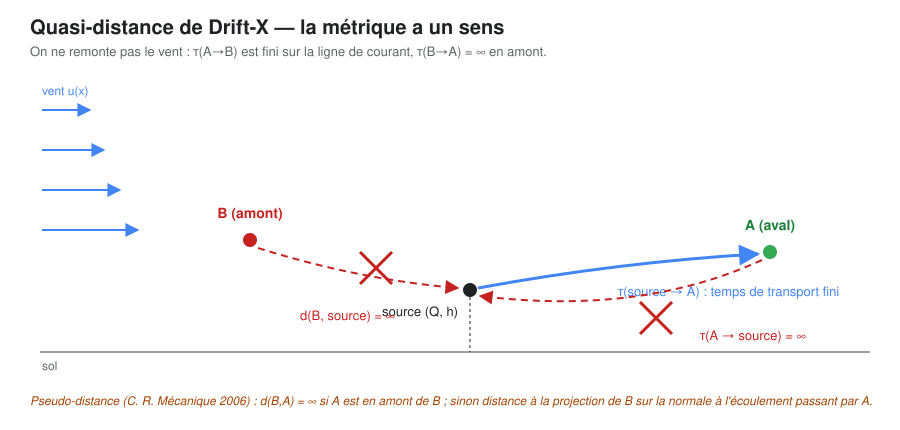

# Les temps de transport dirigés : définitions et limites

Dans la formulation historique de Drift-X [@mohammadi2006crmeca; @brun2008], les solutions de similitude qui supposent un vent **uniforme** (métrique cartésienne) sont envisagées dans une coordonnée naturelle liée au **temps de transport** pour traiter des champs non uniformes. La validité et la portée de cette généralisation doivent être établies à partir des hypothèses et dérivations des sources primaires.

Une construction distincte est désormais étudiée pour la **navigation contrôlée de Zermelo** : le mobile peut choisir une vitesse relative au vent dans une boule admissible. Le problème conduit à un temps minimal de navigation \(T_{\mathrm{nav}}\), différent du temps passif \(T_{\mathrm{arr}}\) défini plus bas. Dans le théorème conditionnel GZ-1 (noyau gaussien 3D idéal), une preuve établit \(T_{\mathrm{nav}}=T_{\mathrm{front}}\) ; voir [Navigation de Zermelo, fronts et Hamilton–Jacobi](navigation-fronts-controllabilite.qmd). Ce résultat conditionnel ne modifie pas les définitions historiques présentées ici.

## Place dans le raisonnement et contrat de lecture

Cette page formalise le **temps de transport** utilisé dans l'hypothèse de généralisation des solutions de similitude. Elle ne démontre pas que la substitution d'une coordonnée uniforme $x/U$ par un temps $\tau$ dans un champ variable conserve l'équation de dispersion ni ses propriétés.

- **Prérequis :** le vocabulaire de [chemins, lignes et temps de transport](../glossaire.qmd#chemins-lignes-et-temps-de-transport) et le cadre des [niveaux de modélisation](../projet/niveaux-modelisation.qmd).
- **Objet défini ici :** distinguer le coût intégré le long d'une courbe, le temps de première arrivée d'une dynamique et la construction historique par projection — avec, pour chacun, domaine, hypothèses, conditions d'existence et statut — puis établir la grille d'axiomes correspondante.
- **Résultat transmis :** les propriétés métriques doivent être examinées séparément dans [Pseudo-distances, coûts orientés et géométries non riemanniennes](metriques-non-riemanniennes.qmd), tandis que les hypothèses et contre-exemples détaillés sont consignés dans [l'investigation G0-S](https://github.com/JM-Brun/J-DriftX/blob/main/docs/19-investigation-g0s-temps-de-parcours.md).
- **Limite actuelle :** la définition projetée historique, son approximation numérique et le temps de première arrivée ne sont pas interchangeables ; aucune conservation générale ni équivalence métrique n'est revendiquée ici.

- **Contre-exemple de cisaillement :** pour \(\mathbf u=(v(y),0)\), le champ est de divergence nulle, mais le coût projeté \(d_A=(x-x_A)/v(y_A)\) vérifie \(\mathbf u\cdot\nabla d_A=v(y)/v(y_A)\), généralement différent de \(1\) hors de la caractéristique de départ. Cela réfute l'implication « incompressibilité \(\Rightarrow\) identité locale de temps pour le coût projeté », pas à lui seul le modèle historique de concentration. La preuve, les propriétés à distinguer et la décision de test sont détaillées dans la [revue mathématique ciblée](https://github.com/JM-Brun/J-DriftX/blob/main/docs/14-revue-mathematique-ciblee.md#3411-portée-logique-du-contre-exemple-et-décision-de-test). Le cas sera automatisé lorsque le dépôt aura une API dédiée à la projection historique; le tester contre la fonction actuelle de temps sur polyligne serait un faux test, car cette fonction représente un autre objet.

Le parcours de lecture est donc : [**modèle direct**](modele-direct.qmd) (équation et hypothèses) → [**similitude**](similitude.qmd#derivation-du-panache-gaussien-regime-etabli) (transformation exacte dans le cas uniforme) → question de généralisation du temps → propriétés géométriques à établir. Cette page traite le dernier passage comme une hypothèse à vérifier, pas comme un résultat déjà acquis. Pour revenir à la dérivation physique exacte de la coordonnée, consulter [l'étape 2 de la dérivation du panache gaussien](similitude.qmd#derivation-du-panache-gaussien-regime-etabli) ; pour les axiomes, poursuivre vers [Métriques non riemanniennes](metriques-non-riemanniennes.qmd).

## Vocabulaire et hypothèses

Pour une présentation synthétique des notions et contre-exemples, voir le [schéma des temps de parcours dirigés](../visuels-g0s/glossaire-g0s.svg) ci-dessous. Il est illustratif : les définitions, hypothèses et preuves restent dans cette page et dans le [glossaire mathématique autonome du dépôt](https://github.com/JM-Brun/J-DriftX/blob/main/docs/30-glossaire-mathematique-autonome-g0s.md). Dans les notes du dépôt, le **temps de première arrivée** porte l'identifiant **$T_{\mathrm{arr}}$** et la **construction projetée historique** (pseudo-distance) l'identifiant **$T_{\mathrm{proj}}$**, lu « temps après projection » ; cette nomenclature est définie dans ce glossaire et dans l'[investigation G0-S](https://github.com/JM-Brun/J-DriftX/blob/main/docs/19-investigation-g0s-temps-de-parcours.md).

Un schéma différenciant ligne de courant, caractéristique, polyligne et navigation minimale est proposé dans le [glossaire](../glossaire.qmd#chemins-lignes-et-temps-de-transport). Le glossaire distingue aussi la navigation minimale du temps de première arrivée sous une dynamique imposée. Le champ de vitesse $\mathbf u$ donne la vitesse locale du fluide. Une ligne de courant est tangente au champ à un instant fixé; une trajectoire de particule suit $\dot X=\mathbf u(X,t)$. Elles coïncident spatialement seulement pour un champ stationnaire (et sous les conditions de régularité appropriées). La définition historique s'appuie sur une caractéristique d'un champ considéré comme stationnaire; son extension à un champ instationnaire ne doit pas être supposée automatique.

La formule ci-dessous suppose une vitesse non nulle le long de la courbe et une trajectoire suffisamment régulière pour que l'intégrale existe. Dans l'article de 2006, un critère écrit avec $\mathbf u\cdot\nabla c$ intervient dans la discussion des projections non uniques; cette expression est la dérivée directionnelle de la concentration dans la direction du vent. Son rôle exact ne doit pas être généralisé sans relire les hypothèses du passage. La reconstruction complète de la projection historique exige en outre des prérequis explicites — domaine et conditions aux limites, unicité de la caractéristique issue de $A$, définition et unicité de la projection de $B$, traitement des sources, puits, séparatrices et stagnations, convention pour les points inaccessibles — développés dans la section « Prérequis de la reconstruction historique » plus bas.

## Définition

Trois objets se succèdent dans la construction de Drift-X. Ils ne sont pas interchangeables : chacun a sa définition, son domaine, ses hypothèses, ses conditions d'existence et son statut. Les définitions, conventions et preuves de référence sont fixées dans l'[investigation G0-S](https://github.com/JM-Brun/J-DriftX/blob/main/docs/19-investigation-g0s-temps-de-parcours.md) et le [glossaire mathématique autonome du dépôt](https://github.com/JM-Brun/J-DriftX/blob/main/docs/30-glossaire-mathematique-autonome-g0s.md) ; la présente page les présente sans les démontrer à nouveau.

### Objet 1 — intégrale d'un coût le long d'une courbe prescrite

Le temps de parcours le long d'une caractéristique orientée $\gamma$, entre deux points appartenant à cette caractéristique, s'écrit

$$
T_\gamma(A,B)=\int_{\gamma_{A\to B}}\frac{ds}{|\mathbf u(s)|}.
$$

- **Domaine et hypothèses.** La courbe est prescrite : fournie d'avance, jamais optimisée ; le calcul ne tient pas compte de l'orientation du vent le long du tracé. Champ stationnaire pour parler de caractéristique, vitesse non nulle sur la courbe.
- **Conditions d'existence.** L'intégrale existe si $|\mathbf u|>0$ sur le tracé et si l'intégrande est intégrable ; une stagnation sur le tracé rend l'intégrande singulier — l'ordre d'annulation décide de la divergence (investigation G0-S, § 4.4–4.5).
- **Statut.** Implémenté (`temps_transport` sur polyligne) et testé ; l'invariance au signe du vent prouve que cet objet n'est **pas** dirigé : un chronomètre le long d'un tracé, pas une métrique.

### Objet 2 — temps de première arrivée ($T_{\mathrm{arr}}$)

Pour un champ autonome $\mathbf u$ sur un domaine $\Omega$, le temps de première arrivée de $A$ vers $B$ est

$$
T_{\mathrm{arr}}(A,B)=\inf\{\,t\ge 0 : X(t;A)=B\,\}, \qquad \inf\varnothing=+\infty,
$$

où $X(t;A)$ est la trajectoire issue de $A$ sous la dynamique $\dot X=\mathbf u(X)$, $X(0)=A$ (définition 2.3 de l'[investigation G0-S](https://github.com/JM-Brun/J-DriftX/blob/main/docs/19-investigation-g0s-temps-de-parcours.md)). C'est une propriété de la **dynamique** : la trajectoire n'est pas prescrite, elle est suivie.

- **Domaine et hypothèses.** Champ stationnaire de classe $C^1$ sur un ouvert $\Omega$ (cadre de base de l'investigation, § 2.1) : existence locale, unicité du flot, dépendance $C^1$ aux conditions initiales (Cauchy–Lipschitz). L'unicité du flot n'est pas décorative : sans elle, le temps dépend de la branche (contre-exemple $\dot x=\sqrt{x}$, investigation § 4.6).
- **Conditions d'existence.** Trois états distincts (investigation § 6.2) : accessible (temps fini) ; inaccessible par orientation ($+\infty$ par convention) ; non-existence par fin de validité dans le domaine ($\sigma_\Omega(A)<T_{\mathrm{arr}}(A,B)$). Les orbites fermées imposent la convention de première arrivée ($T_{\mathrm{arr}}(A,A)=0$ ; le temps de retour est une autre grandeur) ; une cible stagnante en champ $C^1$ n'est jamais atteinte (barrière $C^1$, investigation § 4.5).
- **Statut.** Le cas 1D à vitesse constante est implémenté (`temps_premiere_arrivee_1d`) et testé. Les propriétés générales — non-négativité, séparation, inégalité triangulaire dirigée (propositions 3.2–3.3 de l'investigation) — sont **démontrées sous les hypothèses du cadre de base** ; aucun solveur général du temps de première arrivée n'est implémenté.

### Objet 3 — construction historique par projection ($T_{\mathrm{proj}}$)

**Ce n'est pas à lui seul la définition complète de la pseudo-distance historique de Drift-X.** Dans l'article de Mohammadi & Brun (2006, §3), le point cible $B$ est projeté sur la caractéristique passant par $A$, en $B^\perp$, puis le coût est le temps de migration de $A$ à $B^\perp$. Voir la [source primaire en texte intégral](https://comptes-rendus.academie-sciences.fr/mecanique/item/10.1016/j.crme.2006.06.007.pdf) et la [revue mathématique ciblée](../etat-art/revue-mathematique.qmd).

Cette projection fait partie de la définition : elle signifie que le coût peut ne pas distinguer deux points séparés transversalement. L'article historique le signale explicitement en qualifiant la construction de **pseudo-distance**, qui peut ne pas séparer les points et peut violer l'inégalité triangulaire.

- **Domaine et hypothèses.** Champ stationnaire ; la caractéristique issue de $A$ est unique (sources et puits écartés : hypothèse (H1) de l'investigation) et la projection $B\mapsto B^\perp$ est bien définie (hypothèse (H2)) — cette dernière peut échouer (projection multiple, investigation § 6.1).
- **Conditions d'existence.** Celles de l'objet 2 pour le segment $A\to B^\perp$, plus les prérequis propres à la projection, détaillés dans la section « Prérequis de la reconstruction historique » ci-dessous.
- **Statut.** Une référence analytique en champ uniforme 2D est implémentée (`pseudo_distance_uniforme`) et testée ; la construction générale sur caractéristique courbe n'est pas implémentée et sa valeur peut être non unique. En dimension 1, $T_{\mathrm{proj}}$ coïncide avec $T_{\mathrm{arr}}$ sous les hypothèses explicitées (proposition 5.1 de l'investigation) : les échecs d'axiomes sont des phénomènes de dimension 2 et plus.

## Coût de calcul et statut des trois objets

Les coûts ci-dessous décrivent les opérations nécessaires, pas des mesures de performance. Une complexité asymptotique n'est indiquée que lorsque l'entrée algorithmique est explicite ; le coût de construction d'une courbe ou d'un champ ne doit pas être masqué dans le coût d'évaluation.

| Objet | Calcul requis | Coût d'évaluation identifiable | État dans J-DriftX |
|---|---|---|---|
| Intégrale sur une courbe prescrite $T_\gamma$ | Somme ou quadrature de $ds/|\mathbf u|$ sur le tracé fourni. | Pour une polyligne de $N$ segments et des vitesses déjà fournies : $O(N)$. La génération du tracé et l'interpolation du champ sont hors de ce coût. | `temps_transport` calcule ce coût sur une polyligne ; il ne calcule ni caractéristique ni projection et ignore l'orientation du vent. |
| Temps de première arrivée $T_{\mathrm{arr}}$ | Intégrer l'EDO $\dot X=\mathbf u(X)$ depuis $A$, puis détecter l'atteinte exacte de $B$. | Dépend de l'intégrateur, de la tolérance, du temps d'intégration et du coût d'évaluation/interpolation de $\mathbf u$. Pas de complexité générale annoncée ici ; le coût d'une carte sur de nombreuses cibles est un autre problème. | Seul le cas 1D à vitesse constante est implémenté (`temps_premiere_arrivee_1d`). Aucun solveur général n'est implémenté. |
| Construction projetée historique $T_{\mathrm{proj}}$ | Construire/prolonger la caractéristique issue de $A$, définir une projection de $B$ sur celle-ci, puis calculer le temps jusqu'au projeté. | Coût de la caractéristique + recherche de projection + intégration du temps. La recherche peut être non unique ou mal posée ; aucun coût générique n'est justifié sans règle de projection et algorithme définis. | `pseudo_distance_uniforme` est une formule analytique $O(1)$ en champ uniforme seulement. La construction générale en champ variable n'est pas implémentée. |

**Précision importante sur l'eikonale.** Pour un champ de vitesse imposé et une particule passive, $T_{\mathrm{arr}}$ est défini par l'EDO déterministe ci-dessus : son calcul élémentaire est une intégration de trajectoire avec détection d'événement, pas une minimisation sur toutes les courbes. Une équation de transport telle que $\mathbf u\cdot\nabla T=1$ ne peut décrire une fonction régulière que sur un domaine où une telle fonction est effectivement définie ; elle ne transforme pas la trajectoire issue d'un point unique en une carte de temps régulière sur tout le domaine. L'équation eikonale usuelle, par exemple $|\nabla T|=1/c$, correspond à un problème de temps minimal où le chemin est optimisé sous une vitesse admissible, donc à une autre dynamique (navigation/contrôle). Il ne faut pas attribuer automatiquement ce coût eikonal à $T_{\mathrm{arr}}$.

En conséquence, le coût d'un éventuel solveur eikonal ne doit être imputé qu'à l'objet de navigation minimale qui le requiert effectivement. Pour $T_{\mathrm{arr}}$, le coût pertinent dépend de l'intégration de la dynamique imposée ; pour $T_{\mathrm{proj}}$, il faut ajouter le coût et les difficultés de la projection. Les trois objets n'ont ni le même algorithme ni le même profil de coût. Voir l'[investigation G0-S](../../docs/19-investigation-g0s-temps-de-parcours.md) et le [glossaire mathématique](../../docs/30-glossaire-mathematique-autonome-g0s.md).

Les solutions de similitude formulées en vent uniforme sont réexprimées dans un système lié au temps de transport et à la coordonnée normale. La portée de cette généralisation dépend des hypothèses sur le champ, les caractéristiques et la projection; elle ne découle pas de la seule formule d'intégrale.

### Test analytique d'une coordonnée de transport dans un cisaillement

Ce test distingue un temps de parcours le long d'une caractéristique de la pseudo-distance projetée définie par paires de points. Prenons un champ stationnaire lisse de cisaillement $\mathbf u(x,y)=(v(y),0)$ avec $v(y)>0$, une source $A=(x_A,y_A)$ et une cible aval $B=(x,y)$. La projection historique sur la caractéristique horizontale issue de $A$ donne

$$
d_A(x,y)=\frac{x-x_A}{v(y_A)}.
$$

En considérant $d_A$ comme un champ scalaire sur les points cibles, on obtient

$$
\mathbf u(x,y)\cdot\nabla_{(x,y)}d_A=\frac{v(y)}{v(y_A)}.
$$

Cette quantité n'est généralement pas égale à $1$ lorsque $v(y)\ne v(y_A)$. Elle vaut $1$ sur la caractéristique source $y=y_A$, mais pas sur tout le domaine. Ainsi, la pseudo-distance projetée historique ne satisfait pas en général l'équation locale de temps de transport $\mathbf u\cdot\nabla d_A=1$ partout, même pour un champ lisse, stationnaire et de divergence nulle. Ce contre-exemple n'invalide pas à lui seul le modèle de concentration historique; il montre que la validité de la généralisation des solutions de similitude et toute conservation associée exigent une dérivation propre, et ne découlent pas simplement de la définition de $d_A$. C'est le contre-exemple de cisaillement de l'[investigation G0-S](https://github.com/JM-Brun/J-DriftX/blob/main/docs/19-investigation-g0s-temps-de-parcours.md) (§ 5.3), où il est complété par la caractérisation exacte de l'échec de l'inégalité triangulaire : le temps projeté ne satisfait pas nécessairement $\mathbf u\cdot\nabla\tau=1$ hors de la caractéristique de départ.

### Définition géométrique et approximation numérique

Le chapitre de 2008 distingue implicitement deux objets qu'il faut garder séparés dans J-DriftX :

- **Définition géométrique** : projeter $B$ sur la caractéristique passant par $A$, en $B^\perp$, puis intégrer le temps jusqu'à cette projection.
- **Approximation de calcul** : approximer $B^\perp\approx B$, puis appliquer en champ uniforme le facteur imprimé dans le chapitre comme « $2/3=0.636$ ». Cette égalité est incohérente arithmétiquement; $2/\pi\approx0.637$ correspondrait à la moyenne de $|\cos\theta|$ pour un angle uniforme sur $[0,\pi]$, mais le coefficient exact reste à confirmer dans la source ou le code historique. Le chapitre précise que l'égalité exacte entre la caractéristique issue de $A$ et le point $B$ est peu probable en général, et présente la méthode pour des champs atmosphériques lisses.

Ces deux étapes ne doivent pas être confondues. Le MVP doit d'abord reproduire la définition, puis mesurer séparément l'effet de l'approximation numérique et de sa correction.

## Prérequis de la reconstruction historique

La construction projetée historique ne se réduit pas à la formule d'intégrale : cinq prérequis doivent être explicités avant toute implémentation générale. Ils sont établis dans l'[investigation G0-S](https://github.com/JM-Brun/J-DriftX/blob/main/docs/19-investigation-g0s-temps-de-parcours.md) (§ 2.4 et § 6) et repris dans le [glossaire mathématique autonome](https://github.com/JM-Brun/J-DriftX/blob/main/docs/30-glossaire-mathematique-autonome-g0s.md).

### 1. Domaine et conditions aux limites

L'intégrale et la projection sont définies sur un domaine $\Omega$ explicite. Le temps maximal de validité $\sigma_\Omega(A)$ distingue la non-existence par fin de validité dans le domaine (sortie par la frontière, ou fin d'existence en temps fini) de l'inaccessibilité par orientation : les deux donnent $+\infty$ dans la convention étendue, mais ils n'ont pas la même signification (investigation, conventions (C1)–(C2), § 6.2).

### 2. Unicité de la caractéristique issue de $A$

Le cadre de base (champ $C^1$ stationnaire) garantit l'existence locale et l'unicité du flot (Cauchy–Lipschitz). Sources, puits et séparatrices peuvent faire échouer cette unicité : l'hypothèse (H1) de la source historique les écarte explicitement (investigation, § 2.4).

### 3. Définition et unicité de la projection de $B$

Le point $B^\perp$ doit être défini sans ambiguïté sur la caractéristique $\gamma_A$. La projection peut être non unique — cas extrême : $B$ au centre d'un champ rotationnel, où tout point du cercle $\gamma_A$ est à distance égale de $B$ (investigation, § 6.1). La source historique résout ce cas par un critère en $\mathbf u\cdot\nabla c$ qui dépend de la concentration, donc de la sortie du modèle : cette dépendance circulaire est documentée, non résolue.

### 4. Sources, puits, séparatrices et stagnations

Une stagnation rend l'intégrande $1/|\mathbf u|$ singulier. En champ $C^1$, un point de stagnation n'est ni atteint ni quitté en temps fini, et aucune trajectoire ne le traverse (barrière $C^1$, investigation § 4.5) ; des temps finis au voisinage d'une stagnation exigent une annulation d'ordre non entier, donc un champ non $C^1$ au point considéré, au prix de l'unicité du flot (contre-exemple $\dot x=\sqrt{x}$, investigation § 4.6). Le traitement de ces points doit être spécifié avant tout calcul.

### 5. Convention pour les points inaccessibles

$+\infty$ est un choix de modélisation, pas une propriété démontrée (convention (C1) de l'investigation). Dans le code, la référence uniforme adopte la convention locale suivante : $+\infty$ si la projection de la cible est strictement en amont, valeur nulle sur la frontière transverse. La garde `u_min` du code est une **convention algorithmique** distincte — elle conditionne l'acceptabilité numérique du calcul, pas la définition mathématique (voir [niveaux de modélisation](../projet/niveaux-modelisation.qmd) et l'hypothèse H4 du [catalogue](../hypotheses/catalogue.qmd)).

## Correspondance avec le code actuel

Les définitions géométriques et l'approximation décrites ci-dessus ne se réduisent pas aux trois algorithmes déjà disponibles dans le dépôt. Les définitions mathématiques priment : le code du dépôt est une **implémentation partielle** de ces concepts, pas leur référence. Le dépôt contient trois primitives distinctes, dont les contrats sont visibles dans [`src/jdriftx/metric.py`](https://github.com/JM-Brun/J-DriftX/blob/main/src/jdriftx/metric.py) et dont les comportements sont caractérisés par [`tests/test_metric.py`](https://github.com/JM-Brun/J-DriftX/blob/main/tests/test_metric.py). Une **polyligne** désigne ici une suite de points reliés par des segments droits — le tracé que `temps_transport` reçoit de son appelant ; la notion est définie dans le [glossaire](../glossaire.qmd).

| Objet mathématique | Statut dans le code | Conséquence et tests pertinents |
|---|---|---|
| Intégrale du temps le long d'une trajectoire/caractéristique spécifiée, $T_\gamma(A,B)=\int_\gamma ds/\lVert\mathbf u\rVert$ | `temps_transport(ligne, vent)` calcule une somme discrète longueur/norme de vitesse sur une [polyligne](../glossaire.qmd) **fournie par l'appelant**. Elle ne calcule ni la caractéristique du champ, ni une projection de $B$. | Le coût est invariant par inversion du signe du vent et par renversement de la polyligne : voir `test_polyline_cost_is_invariant_to_path_reversal_and_wind_sign`. Ce test confirme justement que cette primitive n'est pas un temps de transport advectif dirigé. |
| Temps de première arrivée ($T_{\mathrm{arr}}$) en 1D, vitesse constante signée | `temps_premiere_arrivee_1d(a, b, vitesse)` implémente exactement l'EDO `dx/dt = vitesse` sur la droite réelle, avec `+inf` si la cible est inaccessible. | Tests analytiques des deux sens de déplacement, cible identique, vitesse nulle et entrées non finies. Cela ne couvre ni champ variable ni optimisation de trajectoire. |
| Temps minimal de navigation (minimum sur les chemins admissibles) | **Non implémenté en dimension générale.** Le dépôt contient le cas analytique de première arrivée en 1D à vitesse constante, mais aucun solveur général de temps d'arrivée ni optimiseur de chemin en dimension supérieure. | Les propriétés démontrées analytiquement pour la variante de première arrivée dans [l'investigation G0-S](https://github.com/JM-Brun/J-DriftX/blob/main/docs/19-investigation-g0s-temps-de-parcours.md) ne doivent pas être attribuées à `temps_transport` ou à `pseudo_distance_uniforme`. |
| Pseudo-distance projetée historique ($T_{\mathrm{proj}}$, temps après projection) : projeter $B$ sur la caractéristique issue de $A$, puis intégrer jusqu'à $B^\perp$ | `pseudo_distance_uniforme(a, b, vent)` est une **référence analytique en champ uniforme 2D**. Elle utilise la projection longitudinale sur la direction du vent, ignore l'écart transversal et renvoie $+\infty$ si la projection longitudinale est négative. | `test_uniform_pseudodistance_uses_longitudinal_projection`, `test_uniform_pseudodistance_is_zero_for_distinct_points`, `test_uniform_pseudodistance_is_infinite_upwind`, `test_uniform_pseudodistance_is_asymmetric_along_the_wind` (non-symétrie : fini vers l’aval, $+\infty$ vers l’amont) et les tests de formule fermée caractérisent cette convention locale. Ils ne démontrent pas une reproduction complète de la construction historique. |

**Pourquoi ces trois fonctions existent.** Aucune n'est la métrique visée : chacune réalise un morceau du concept, choisi le plus simple possible pour pouvoir être vérifié exactement.

- `temps_transport` — *le chemin qu'on lui donne.* On lui fournit un tracé (une [polyligne](../glossaire.qmd) : des étapes reliées par des segments droits) et la fonction additionne la durée de chaque segment : longueur divisée par vitesse. Elle ne cherche pas le chemin le plus rapide, ne tient pas compte du sens du vent et n'utilise aucune autre information sur le champ : un chronomètre le long d'un tracé, rien de plus. C'est volontaire — son test d'invariance au signe du vent prouve ce qu'elle *n'est pas*, pour qu'on ne la confonde pas avec la métrique dirigée visée.
- `temps_premiere_arrivee_1d` — *un cas de référence analytique.* En une dimension, avec une vitesse constante signée, le temps de première arrivée se calcule par une formule explicite : déplacement divisé par la vitesse lorsque la cible est dans le sens du mouvement, $+\infty$ sinon, et zéro si la cible coïncide avec le départ (y compris si la vitesse est nulle). Les tests comparent le code à ces résultats analytiques avec les tolérances adaptées ; ils ne constituent pas une preuve générale pour des champs variables.
- `pseudo_distance_uniforme` — *une référence analytique inspirée de la construction historique, en vent uniforme.* Projeter $B$ sur la ligne de vent issue de $A$, puis compter le temps jusqu'à cette projection : dans un champ uniforme, chaque ingrédient s'écrit en formule fermée. La fonction fixe une spécification vérifiable pour les cas non dégénérés (projection longitudinale, décalage transversal non facturé, cible en amont : $+\infty$). Son résultat nul pour une cible distincte projetée sur la source est une extension dégénérée du code, non conforme à la condition historique $B^\perp\ne A$ ; ce cas reste à arbitrer dans le contrat mathématique.

Deux limites sont visibles dans les tests du code : (1) `temps_transport` ne change pas si l'on inverse le vent, contrairement à ce qu'exigerait une représentation dirigée de l'advection ; (2) `pseudo_distance_uniforme` vaut zéro pour des points distincts séparés uniquement transversalement. Le second résultat découle de la projection longitudinale utilisée dans cette référence analytique uniforme. **Il ne reproduit toutefois pas la condition de non-dégénérescence écrite dans l'article historique** : l'article exige $B^\perp\ne A$ pour que $d(A,B)=0\Rightarrow A=B$. Pour une cible transverse dont la projection coïncide avec la source, l'implémentation actuelle étend donc la formule à un cas dégénéré que la définition historique exclut ou doit traiter séparément. Ce n'est pas une erreur d'arrondi, mais ce n'est pas non plus un comportement historiquement validé. La convention à retenir (exclusion du domaine, valeur infinie/indéfinie, ou pseudo-distance dégénérée explicitement assumée) doit être décidée dans le contrat mathématique et les tests, pas implicitement héritée du code.

**Limite de preuve :** ces tests vérifient les contrats des fonctions implémentées dans le cas uniforme et sur polyligne. Ils ne valident ni l'intégration d'une caractéristique dans un champ variable, ni l'optimisation d'un temps de première arrivée, ni la fidélité de la fonction de référence à chaque détail historique de Drift-X. Ces trois points doivent rester séparés dans les issues MVP-S et état de l'art.

## Lien avec la mécanique des fluides

Pour un traceur passif de concentration $C$, l'équation conservative d'advection avec source $S$ est $\partial_t C+\nabla\cdot(C\mathbf u)=S$. Si $\nabla\cdot\mathbf u=0$, elle devient $\partial_t C+\mathbf u\cdot\nabla C=S$. Les caractéristiques suivent la vitesse du fluide et permettent de décrire le transport advectif. Cette interprétation est une passerelle physique, pas une preuve que la pseudo-distance projetée suffit à reconstruire la concentration.

La divergence nulle signifie qu'il n'y a pas de dilatation volumique locale du champ; pour un fluide à densité constante, elle exprime l'incompressibilité cinématique. Elle ne prouve pas seule la conservation du flux sur une surface iso-$\tau$. Il faut dériver le changement de coordonnées et son jacobien, préciser les conditions aux limites et tenir compte des sources/puits. La diffusion, la turbulence et le dépôt ne sont pas inclus dans la simple intégrale $\int ds/\|\mathbf u\|$.

## Trois propriétés structurantes

**Non-symétrie : condition à préciser.** La non-uniformité du champ ne suffit pas, à elle seule, à rendre asymétrique l'intégrale $\int ds/|\mathbf u|$ si l'on parcourt la même courbe dans les deux sens. Dans l'advection pure, l'asymétrie peut venir de la dynamique orientée : la trajectoire inverse n'est généralement pas admissible pour le même champ. Il faut alors préciser si le temps inverse est non défini, infini par convention, ou calculé avec une autre dynamique. Voir la [revue mathématique ciblée](../etat-art/revue-mathematique.qmd).

**Stagnation : singularité à analyser.** L'intégrande $1/|\mathbf u|$ devient singulier quand $|\mathbf u|\to0$, mais la divergence de l'intégrale dépend du comportement local du champ et de la trajectoire. Le domaine admissible et le traitement des points stagnants doivent être spécifiés; la divergence n'est pas une conséquence automatique de la seule limite ponctuelle.

**Conservation : distinguer la contrainte historique du théorème à démontrer.** L’article de 2006 impose une contrainte globale de conservation de la quantité émise, et le chapitre de 2008 demande que la quantité intégrée du scalaire transporté soit conservée par le modèle réduit. Dans les passages examinés, ces sources ne fournissent pas une démonstration générale de la conservation du flux sur toute surface iso-$\tau$. L’article Springer de 2009 affirme également une conservation dans la restriction multi-niveaux (équation 28), mais l’égalité imprimée entre une intégrale volumique de concentration et une intégrale de bord avec vitesse normalisée présente, sous l’interprétation usuelle de concentration volumique, une incohérence dimensionnelle apparente. Cette ligne doit être vérifiée dans ses conventions et son contexte avant d’être reprise comme preuve ; ce constat n’établit pas à lui seul que le modèle est invalide. Le théorème de la divergence établit seulement, sous des hypothèses adaptées, l’égalité du débit volumique $\int_S \mathbf u\cdot\mathbf n\,dS$ entre deux sections d’un même tube de courant si $\nabla\cdot\mathbf u=0$. Pour la quantité transportée, il faut partir du bilan de $c\mathbf u$ et expliciter sources, pertes, frontières et domaine d’intégration. Voir la [revue mathématique ciblée](../etat-art/revue-mathematique.qmd) pour les hypothèses et les limites de ce résultat conditionnel.

Selon le domaine et les axiomes démontrés, $\tau$ peut relever d'une fonction de coût orientée ou d'une quasi-distance étendue; le terme « métrique » ne doit pas être utilisé sans qualification avant vérification de la séparation, de l'inégalité triangulaire et du traitement des points inaccessibles. La généalogie des objets voisins est détaillée sur la page [Métriques non riemanniennes](metriques-non-riemanniennes.qmd) et dans la [revue mathématique ciblée](../etat-art/revue-mathematique.qmd).

## Grille d'axiomes

Les axiomes de distance sont notés (D1)–(D4) dans l'[investigation G0-S](https://github.com/JM-Brun/J-DriftX/blob/main/docs/19-investigation-g0s-temps-de-parcours.md) (§ 2.5) : (D1) diagonale nulle, (D2) non-négativité, (D3) inégalité triangulaire dirigée, (D4) séparation. Une **quasi-distance étendue** vérifie (D1)–(D4) ; une distance vérifie en outre la symétrie et la finitude. Statut par propriété et par objet :

| Propriété | Objet 1 — coût sur courbe prescrite | Objet 2 — première arrivée ($T_{\mathrm{arr}}$) | Objet 3 — projection historique ($T_{\mathrm{proj}}$) |
|---|---|---|---|
| Non-négativité (D2) | Démontrée sur la courbe (intégrande positive) | Démontrée par définition (infimum sur $[0,+\infty[$) | Démontrée (hérite de $T_{\mathrm{arr}}$ sur le segment projeté ; convention $+\infty$ en amont) |
| Diagonale nulle (D1) | Démontrée (segment de longueur nulle) | Démontrée ($t=0$ admis dans l'infimum) | Démontrée lorsque la projection de $A$ sur sa propre caractéristique est bien définie |
| Séparation (D4) | **Sans objet** : le coût dépend du tracé prescrit, ce n'est pas une fonction de paires | **Démontrée** sous les hypothèses du cadre de base (proposition 3.2) | **Réfutée** pour la convention du code dès la dimension 2 : coût nul pour des points distincts de même abscisse (cas dégénéré $B^\perp=A$, testé dans le code) ; la source historique exclut ce cas par la condition $B^\perp\ne A$ — l'échec dépend donc de la convention retenue (voir « Correspondance avec le code ») |
| Inégalité triangulaire (D3) | **Sans objet** | **Démontrée** au sens étendu via le semi-groupe du flot (proposition 3.3) ; stricte possible sur orbite fermée (exemple 3.5) | **Réfutée** en champ de cisaillement non uniforme (caractérisation exacte, lemme 5.4, contre-exemple 5.6) ; égalité en champ uniforme ; contre-exemple contrôlé numériquement |
| Symétrie | **Sans objet** | **Réfutée** structurellement ($T_{\mathrm{arr}}(B,A)=+\infty$ possible alors que l'aller est fini) ; bilatérale sur les orbites fermées (proposition 3.7) | **Réfutée** ($+\infty$ vers l'amont) |
| Finitude | **Sans objet** | Réfutée : $+\infty$ amont, non-existence par sortie de domaine | Réfutée : idem |
| Convention d'inaccessibilité ($+\infty$) | Non applicable : tout tracé est admissible, l'objet ignore l'orientation | Convention de modélisation (C1), distincte de la non-existence par fin de validité (C2) | Convention locale du code en champ uniforme : $+\infty$ si la projection est strictement en amont |
| Unicité de la valeur | Dépend du tracé prescrit | Oui (flot unique sous $C^1$) | **Non établie en général** : projection multiple possible (investigation § 6.1) |

Les statuts « démontrée / réfutée » sont ceux des propositions et du tableau récapitulatif (§ 8) de l'investigation G0-S ; les mentions « testée » renvoient aux tests du dépôt recensés dans la [matrice MVP-S](https://github.com/JM-Brun/J-DriftX/blob/main/docs/27-matrice-tracabilite-mvp-s.md). Rien de tout cela n'est établi pour des champs instationnaires (hors périmètre).

### Des familles à ne pas confondre

La grille interdit les confusions de famille. $T_{\mathrm{proj}}$ peut échouer à la séparation **et** à l'inégalité triangulaire : ce n'est pas une quasi-métrique au sens usuel (non symétrique mais triangulaire), et « pseudo-distance » est la qualification que la source historique donne elle-même à sa construction projetée. $T_{\mathrm{arr}}$ vérifie (D1)–(D4) sous les hypothèses du cadre de base : une **quasi-distance étendue**, pas une distance (ni symétrique ni finie en général). Les rapprochements avec Finsler, Randers et la navigation de Zermelo décrivent un navigateur **contrôlable**, pas un traceur passif : ce sont des analogies explicites, détaillées dans [Pseudo-distances, coûts orientés et géométries non riemanniennes](metriques-non-riemanniennes.qmd).

## Analogie avec l'adaptation de maillage par métrique

L'adaptation de maillage anisotrope [@borouchaki1997delaunay] et la pseudo-distance travel-time partagent l'idée générale qu'une géométrie utile dépend du problème plutôt que de la seule distance euclidienne. Ce rapprochement reste toutefois une analogie conceptuelle : la référence sur les maillages ne démontre ni une filiation historique directe, ni une équivalence mathématique entre les deux constructions. La table des familles géométriques voisines (dont la métrique de maillage) est détaillée sur la page [Métriques non riemanniennes](metriques-non-riemanniennes.qmd).

## Ce qui reste à formaliser (reprise v2)

- Une définition autonome et auto-contenue de $\tau$ et de ses propriétés (actuellement dispersée entre la thèse [@brun2006these], le CR Mécanique et le chapitre Springer) — objectif M0/M1.
- La correspondance exacte entre la contrainte historique $\int_{\mathbb R^3}c\,dV=Q$ / $C=\int_{\mathbb R^2}c^+\,d\sigma$ et toute affirmation de flux conservé sur une surface iso-$\tau$ : aucune équivalence générale n’est revendiquée sans dérivation source à l’appui.
- L'estimateur d'erreur entre niveaux dans la hiérarchie multi-échelles — objectif M2.
- Le traitement du régime $|\mathbf{u}| \to 0$ (troncature, physique de stagnation) — voir [Limites](../hypotheses/limites.qmd).
