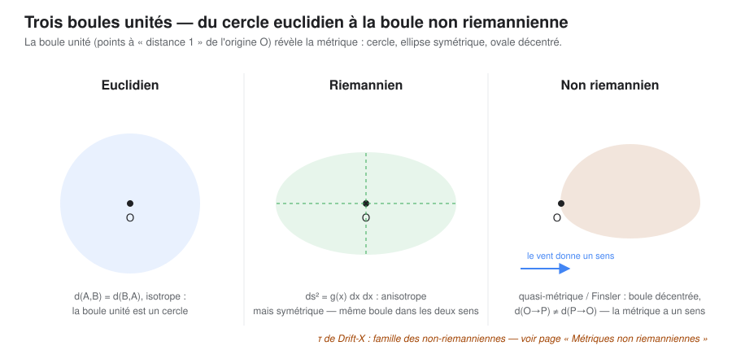

# Des coûts orientés aux métriques non riemanniennes

Le travel-time de Drift-X est un **objet de coût orienté construit à partir d'un champ de vitesse**. Il est lié à plusieurs familles géométriques, mais ne doit pas être classé comme métrique de Finsler ou quasi-métrique avant que ses axiomes soient vérifiés. Cette page situe les analogies utiles — distances-temps géographiques, géométrie de Finsler et métriques d'adaptation de maillage — sans supposer qu'elles sont équivalentes.

## Place dans le raisonnement et contrat de lecture

Cette page intervient **après la définition du travel-time** : elle classe les objets voisins et compare leurs axiomes, sans conclure qu'ils sont équivalents parce qu'ils partagent une intuition de coût orienté.

- **Prérequis :** les trois constructions distinguées dans [Métrique travel-time](metrique-travel-time.qmd) : intégrale le long d'une courbe, temps de première arrivée, et pseudo-distance projetée historique.
- **Question traitée ici :** quelles propriétés définissent les familles géométriques voisines et lesquelles sont effectivement établies pour la construction étudiée ?
- **Résultat transmis :** une analogie avec une quasi-métrique, Finsler ou Randers reste une piste de positionnement tant que les axiomes et les hypothèses ne sont pas démontrés pour l'objet exact.
- **Limite actuelle :** la construction projetée historique peut échouer à la séparation et à l'inégalité triangulaire ; elle ne doit donc pas être qualifiée de quasi-métrique au sens usuel sans une définition différente ou une preuve correspondante.

Pour les définitions et le contre-exemple de cisaillement, revenir à [Métrique travel-time](metrique-travel-time.qmd). Pour les preuves et contre-exemples complets, consulter [l'investigation G0-S](https://github.com/JM-Brun/J-DriftX/blob/main/docs/19-investigation-g0s-temps-de-parcours.md) et la [matrice MVP-S](https://github.com/JM-Brun/J-DriftX/blob/main/docs/27-matrice-tracabilite-mvp-s.md).

## Riemannien, non riemannien : de quoi parle-t-on ?

Une métrique **riemannienne** mesure les longueurs à l'aide d'un produit scalaire $g(\mathbf{x})$ qui varie doucement d'un point à l'autre : $ds^2 = g_{ij}\, dx^i dx^j$. La distance euclidienne du plan en est le cas particulier le plus simple. Elle est **symétrique et réversible** : la longueur d'un chemin ne dépend pas du sens dans lequel on le parcourt.

Les familles ci-dessous ne sont pas interchangeables. En particulier, une pseudo-distance qui viole l'inégalité triangulaire n'est pas une quasi-métrique au sens usuel :

| Famille / objet | Propriété distinctive | Exemple ou précaution |
|---|---|---|
| **Pseudo-distance** | Peut échouer à séparer les points; selon la construction, d'autres axiomes peuvent aussi échouer | La construction historique projetée de Drift-X |
| **Quasi-métrique** | Non symétrique, mais satisfait l'inégalité triangulaire selon la convention adoptée | Certains coûts orientés de réseau; ne pas y classer Drift-X sans vérifier la triangulation |
| **Métrique de Finsler** | La longueur infinitésimale dépend de la position et de la direction | Navigation de Zermelo dans un courant, avec trajectoire contrôlable |
| Distance-temps réseau | Le coût est défini sur un réseau (routes, rails) | Isochrones d'un réseau de transport |
| Métrique de maillage | La longueur est pondérée par un tenseur anisotrope $M(\mathbf{x})$ | Adaptation de maillage [@borouchaki1997delaunay] |

## L'ancrage géographique : les distances-temps de Muller (1979)

L'idée que les postulats de la géométrie euclidienne sont souvent inapplicables en géographie humaine est ancienne. Jean-Claude Muller la formalise pour la cartographie : les distances et localisations géographiques **ne sont pas uniques** et varient suivant le type d'espace envisagé — économique, social, culturel ou mental ; parfois même, la métrique de ces espaces est **inconnue ou incomplète** [@muller1979persee]. Sa réponse : cartographier une métrique non euclidienne, la **distance-temps** — le temps de parcours du réseau de transport plutôt que les mètres au sol — et en accepter les déformations (isochrones, anamorphoses).

Drift-X présente une **analogie** avec ce programme, mais change la construction : le coût est défini à partir d'un champ de vent et d'une projection caractéristique plutôt que d'un réseau de transport. L'hypothèse de divergence nulle est une condition physique/mathématique distincte; elle ne suffit pas à transformer le coût en métrique ni à démontrer une conservation sur toute surface iso-$\tau$. L'article de 2006 propose une pseudo-distance de transport (voir [Métrique travel-time](metrique-travel-time.qmd)). Elle ne se réduit pas toujours au temps d'arrivée au point cible : pour un point de départ $A$, le point $B$ est projeté sur la caractéristique issue de $A$, en $B^\perp$, et le coût est le temps de migration de $A$ à $B^\perp$. Le temps le long d'une caractéristique entre deux points de celle-ci s'écrit

$$
T_\gamma(A,B)=\int_{\gamma_{A\to B}}\frac{ds}{|\mathbf u(s)|}.
$$

La construction historique a donc une dégénérescence transversale assumée : dans un champ uniforme $\mathbf u=(U,0)$, elle donne $d(A,B)=(x_B-x_A)/U$ pour $x_B\ge x_A$, indépendamment de $y_B-y_A$. La source de 2006 précise que $d(A,B)=0$ ne garantit pas $A=B$, et que l'inégalité triangulaire peut échouer. Voir le [texte intégral de l'article](https://comptes-rendus.academie-sciences.fr/mecanique/item/10.1016/j.crme.2006.06.007.pdf) et la [revue mathématique ciblée](../etat-art/revue-mathematique.qmd).

## Le lien mathématique : navigation de Zermelo et métriques de Finsler

Le problème de **Zermelo** (1931) demande le chemin le plus rapide d'un point à un autre pour un mobile de vitesse propre fixe naviguant dans un **courant**. Sous les hypothèses usuelles de vitesse propre et de courant, sa formulation conduit à une géométrie de **Randers**, cas particulier des métriques de Finsler : la longueur effective dépend de la direction et naviguer avec le courant peut coûter moins cher que contre lui. Cela décrit un navigateur contrôlable, pas directement un traceur passif.

Un traceur passif en advection pure suit le champ de vitesse; il ne choisit pas librement une direction comme le navigateur de Zermelo. Pour des points non situés sur la même trajectoire orientée, le temps advectif peut être non défini; le poser égal à $+\infty$ est une convention de coût étendu qui doit être explicitée. Cette formulation n'est donc pas automatiquement une métrique de Randers, ni une métrique finie. La non-symétrie découle ici de l'accessibilité orientée, pas simplement de la non-uniformité du champ.

## Analogies utiles et hypothèse d'apport

- **Analogie géographique** [@muller1979persee] : la distance pertinente peut être le temps de parcours plutôt que les mètres au sol ; la carte se déforme pour représenter cette mesure (isochrones, anamorphoses). Ce rapprochement n'établit pas de filiation historique directe avec Drift-X.
- **Analogie numérique** [@borouchaki1997delaunay] : dans les deux domaines, une structure géométrique adaptée au problème peut guider le calcul. Cette analogie ne constitue ni une technologie transférée ni une filiation historique démontrée.
- **Hypothèse d'apport Drift-X à établir** : une représentation de temps de transport reconstruite à partir d'un champ de vent, avec des propriétés de conservation et une évaluation ponctuelle à formaliser. Ces propriétés ne découlent pas du seul vocabulaire de métrique; elles demandent une dérivation, des hypothèses explicites et des cas de vérification.

La définition exacte, les propriétés à vérifier et la comparaison aux formulations voisines sont discutées dans la [revue mathématique ciblée](../etat-art/revue-mathematique.qmd). Voir aussi la page [Métrique travel-time](metrique-travel-time.qmd).

**Traçabilité de l'implémentation.** Les propriétés de la définition historique ne doivent pas être attribuées automatiquement au prototype Python. La [matrice MVP-S](https://github.com/JM-Brun/J-DriftX/blob/main/docs/27-matrice-tracabilite-mvp-s.md) précise les cas analytiques couverts, les fonctions concernées et les limites des tests.
